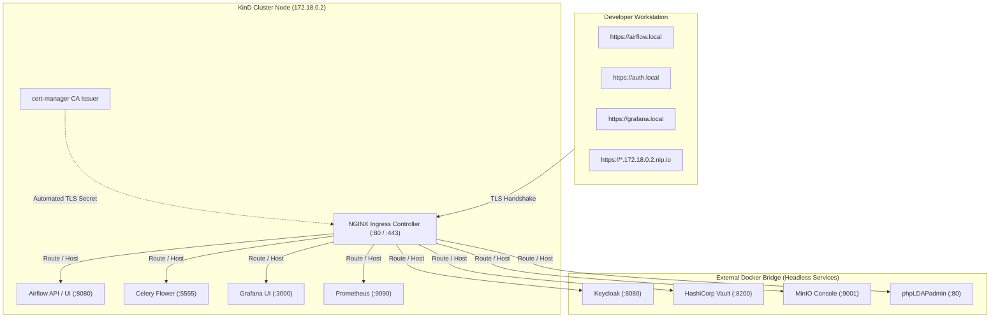

# Cluster Access & UI Endpoints Reference

This document provides a complete directory of all **8 Web UIs, Consoles, and Access Endpoints** running in the Apache Airflow 3 Enterprise Kubernetes lab, along with authentication credentials, team personas, and network routing details.

---

## 1. Web UIs & Consoles Directory

All web interfaces are available via **Enterprise TLS Ingress** (HTTPS) and direct **Docker / NodePort** port forwarding (HTTP fallback).

| Service | Secure HTTPS (Ingress) | Direct HTTP (Localhost) | Username / Credentials | Purpose & Capabilities |
|:---|:---|:---|:---|:---|
| **Airflow Web UI** | [https://airflow.local](https://airflow.local)<br>*(or [nip.io](https://airflow.172.18.0.2.nip.io))* | [http://localhost:8080](http://localhost:8080) | Click **"Sign in with keycloak"**<br>*(See Team Personas below)* | Core Airflow UI: DAG orchestration, task execution logs, pipeline triggering, and audit logs. |
| **Grafana Dashboards** | [https://grafana.local](https://grafana.local)<br>*(or [nip.io](https://grafana.172.18.0.2.nip.io))* | `kubectl port-forward svc/grafana 3000:3000 -n observability` | Auto-login (**Admin**)<br>*(or `admin` / `admin`)* | Production observability: scheduler heartbeats, Celery worker capacity, task throughput, and Unified Alerting rules. |
| **Prometheus Query UI** | [https://prometheus.local](https://prometheus.local)<br>*(or [nip.io](https://prometheus.172.18.0.2.nip.io))* | `kubectl port-forward svc/prometheus 9090:9090 -n observability` | *No auth required* | Metrics engine: raw PromQL queries, target scrape health (`/targets`), alert rules, and TSDB time-series analysis. |
| **Keycloak Admin Console** | [https://auth.local](https://auth.local)<br>*(or [nip.io](https://auth.172.18.0.2.nip.io))* | [http://localhost:8081](http://localhost:8081) | **User:** `admin`<br>**Pass:** `admin`<br>*(Realm: `airflow`)* | Corporate Identity Provider: LDAP User Federation, OIDC clients, token lifecycle, and role mappings. |
| **Flower (Celery Monitor)** | [https://flower.local](https://flower.local)<br>*(or [nip.io](https://flower.172.18.0.2.nip.io))* | [http://localhost:5555](http://localhost:5555) | *No auth required* | Celery execution pool monitor: active worker nodes, running tasks, queue latency, and task failure events. |
| **MinIO S3 Console** | [https://minio.local](https://minio.local)<br>*(or [nip.io](https://minio.172.18.0.2.nip.io))* | [http://localhost:9001](http://localhost:9001) | **User:** `minioadmin`<br>**Pass:** `minioadmin` | S3-compatible remote storage: inspect persisted task logs under bucket `s3://airflow-logs`. |
| **HashiCorp Vault UI** | [https://vault.local](https://vault.local)<br>*(or [nip.io](https://vault.172.18.0.2.nip.io))* | [http://localhost:8200](http://localhost:8200) | **Method:** Token<br>**Token:** `airflow-vault-root-token-2026` | Enterprise secrets management: KV v2 secrets engine, connection URIs, AppRole, and Kubernetes auth backends. |
| **phpLDAPadmin** | [https://ldap.local](https://ldap.local)<br>*(or [nip.io](https://ldap.172.18.0.2.nip.io))* | [http://localhost:8082](http://localhost:8082) | **DN:** `cn=admin,dc=example,dc=org`<br>**Pass:** `admin` | Active Directory / LDAP directory tree browser: view/edit users (`ou=users`) and security groups (`ou=groups`). |

---

## 2. Team Personas & Dynamic RBAC Login Matrix

When accessing the Airflow Web UI ([https://airflow.local](https://airflow.local)), click **"Sign in with keycloak"** and sign in using any of the enterprise LDAP personas below:

| Username | Password | Active Directory Group | Visible / Authorized DAGs | Access Level |
|:---|:---|:---|:---|:---|
| **`alice`** | `Alice-lab-1` | `airflow-admins` | **All DAGs** | **Full Administrator** (Can view, trigger, pause, and edit all pipelines). |
| **`user_finance`** | `Finance-lab-1` | `aid-finance-auth` | `finance_monthly_report` | **Finance Team Operator** (Isolated to finance workflows only). |
| **`user_analytics`** | `Analytics-lab-1` | `aid-analytics-auth` | `analytics_daily_etl` | **Analytics Team Operator** (Isolated to analytics data ingestion). |
| **`user_marketing`** | `Marketing-lab-1` | `aid-marketing-auth` | `marketing_campaign_tracker` | **Marketing Team Operator** (Isolated to marketing pipelines). |
| **`user_logistics`** | `Logistics-lab-1` | `aid-logistics-auth` | `logistics_fleet_monitoring` | **Logistics Team Operator** (Isolated to logistics tracking). |
| **`breakglass`** | `ChangeMeInSecret123!` | *Direct DB Admin* | **All DAGs** | **Emergency Break-glass** (Bypasses IdP in case Keycloak/LDAP is offline). |

---

## 3. Network Architecture & DNS Resolution



### DNS Mapping Options
1. **Short Clean Domains (`*.local`)**:
   - Configured via `/etc/hosts` pointing to the KinD node IP (`172.18.0.2`).
   - Run `sudo ./ctl hosts` to automatically audit or add the records.
2. **Wildcard Domains (`*.172.18.0.2.nip.io`)**:
   - Zero-configuration fallback that works immediately without modifying system hosts.
   - Example: `https://airflow.172.18.0.2.nip.io`, `https://grafana.172.18.0.2.nip.io`.

### TLS & SSL Certificates
- All HTTPS traffic is terminated at the NGINX Ingress Controller using certificates signed by the cluster root CA (`airflow-ca-issuer`).
- When navigating to `https://*.local` or `https://*.nip.io`, your browser will show a self-signed warning. Click **Advanced → Proceed** (or trust the root CA).

---

## 4. Useful CLI Helpers

The portable `./ctl` CLI provides built-in shortcuts to inspect endpoints and launch services:

```bash
# Print current cluster status and all access URLs
./ctl status

# Verify or add DNS entries in /etc/hosts
sudo ./ctl hosts

# View Ingress routes and TLS certificate statuses
./ctl ingress

# View Prometheus & Grafana dashboard endpoints
./ctl metrics

# View HashiCorp Vault status and root token
./ctl vault ui

# View OpenLDAP / phpLDAPadmin status and login DN
./ctl ldap ui

# Test Keycloak OIDC authentication for all team personas
./ctl test-auth

# Back up OpenLDAP directory to MinIO S3 (s3://airflow-backups/ldap/)
./ctl ldap backup

# Restore OpenLDAP directory from MinIO S3 backup
./ctl ldap restore

# Trigger failure alert email to Gmail (alerts@example.com)
./ctl test-alert

# Trigger Grafana platform health alert email to Gmail
./ctl test-grafana-alert
```
