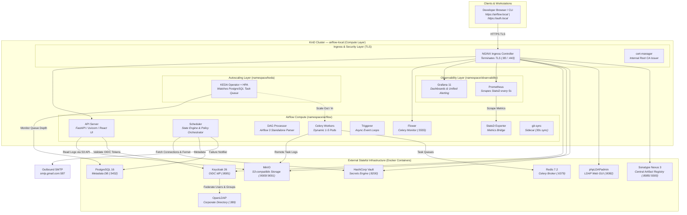
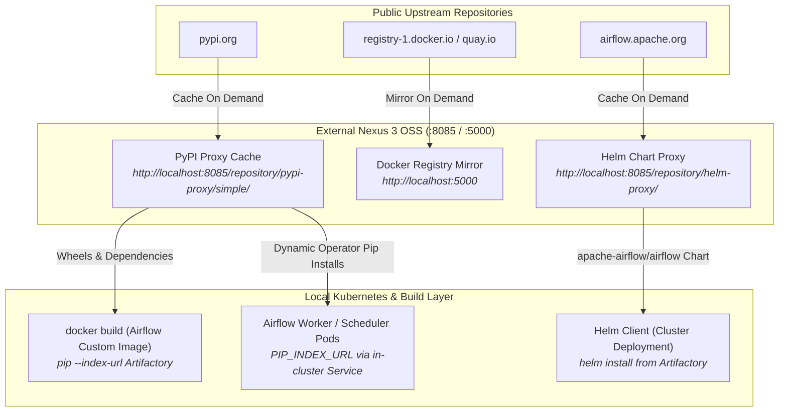
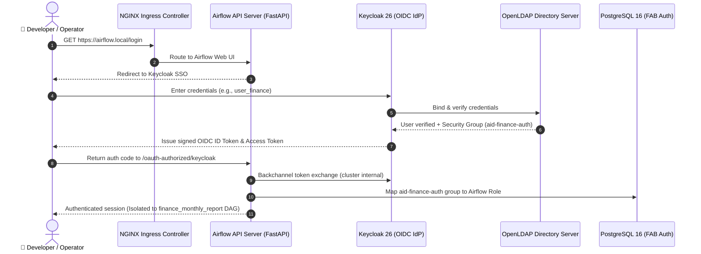

# Apache Airflow 3 — Enterprise Kubernetes Reference Architecture

[](https://airflow.apache.org/)
[](https://www.keycloak.org/)
[](https://kind.sigs.k8s.io/)
[](https://www.vaultproject.io/)
[](https://min.io/)
[](https://www.sonatype.com/products/sonatype-nexus-oss)
[](https://keda.sh/)
[](https://grafana.com/)

A production-grade, local Kubernetes (**KinD**) implementation of **Apache Airflow 3.3.2** wired into a full enterprise infrastructure and security perimeter:
* **OpenLDAP → Keycloak OIDC SSO → Dynamic Owner-Based RBAC** with department isolation
* **HashiCorp Vault** KV-v2 external secrets backend
* **MinIO S3** remote task log persistence and automated LDAP disaster recovery backups
* **Sonatype Nexus 3 OSS (Artifactory)** local caching proxy for air-gapped PyPI wheels, Docker Hub images, and Helm charts
* **CeleryExecutor** backed by **PostgreSQL 16** and **Redis 7.2**
* **KEDA** event-driven worker autoscaling triggered by queue depth
* **Prometheus & Grafana 11** observability stack with unified alerting
* **NGINX Ingress** with automated TLS certificate management via **cert-manager**

Everything runs locally with a single command — **no cloud accounts or paid licenses required**.

---

## Table of Contents

- [1. System Architecture & Topology](#1-system-architecture--topology)
  - [High-Level Component Architecture](#high-level-component-architecture)
  - [Air-Gapped Artifact Flow (Nexus / Artifactory)](#air-gapped-artifact-flow-nexus--artifactory)
  - [SSO & Multi-Tenant RBAC Authentication Sequence](#sso--multi-tenant-rbac-authentication-sequence)
- [2. Access Endpoints & Web Consoles Directory](#2-access-endpoints--web-consoles-directory)
  - [Web UIs & Consoles](#web-uis--consoles)
  - [Enterprise User Persona & RBAC Matrix](#enterprise-user-persona--rbac-matrix)
- [3. Core Architecture Pillars](#3-core-architecture-pillars)
  - [A. Dynamic Owner-Based RBAC](#a-dynamic-owner-based-rbac)
  - [B. Enterprise SSO & LDAP User Federation](#b-enterprise-sso--ldap-user-federation)
  - [C. Central Artifact Repository (Artifactory / Nexus 3)](#c-central-artifact-repository-artifactory--nexus-3)
  - [D. External Secrets Management (HashiCorp Vault)](#d-external-secrets-management-hashicorp-vault)
  - [E. Remote S3 Object Storage & Backups (MinIO)](#e-remote-s3-object-storage--backups-minio)
  - [F. Event-Driven Worker Autoscaling (KEDA)](#f-event-driven-worker-autoscaling-keda)
  - [G. Observability & Alerting (Prometheus & Grafana)](#g-observability--alerting-prometheus--grafana)
- [4. Quick Start](#4-quick-start)
  - [Prerequisites](#prerequisites)
  - [Installation & Startup](#installation--startup)
  - [DNS Setup (Optional TLS Domains)](#dns-setup-optional-tls-domains)
- [5. Portable Control CLI Reference (`./ctl`)](#5-portable-control-cli-reference-ctl)
- [6. DAG Authoring Guidelines & Quality Gates](#6-dag-authoring-guidelines--quality-gates)
- [7. Repository Structure](#7-repository-structure)
- [8. Troubleshooting Guide](#8-troubleshooting-guide)

---

## 1. System Architecture & Topology

The architecture mirrors enterprise best practices where **stateful data services live outside compute nodes** on dedicated host networks, bridged into the Kubernetes cluster through headless `Service` and `Endpoints` definitions.

### High-Level Component Architecture



---

### Air-Gapped Artifact Flow (Nexus / Artifactory)

To prevent cluster builds from depending directly on the public internet, **Sonatype Nexus 3 OSS** acts as a central proxy and caching barrier:



---

### SSO & Multi-Tenant RBAC Authentication Sequence



---

## 2. Access Endpoints & Web Consoles Directory

All web interfaces are accessible via **Enterprise TLS Ingress (HTTPS)** and direct **NodePort / localhost port forward (HTTP fallback)**:

### Web UIs & Consoles

| Service | Secure HTTPS (Ingress) | Direct HTTP (Localhost) | Credentials | Purpose |
| :--- | :--- | :--- | :--- | :--- |
| **Airflow Web UI** | [https://airflow.local](https://airflow.local)<br>*(or [nip.io](https://airflow.172.18.0.2.nip.io))* | [http://localhost:8080](http://localhost:8080) | Click **"Sign in with keycloak"** *(See personas below)* | DAG orchestration, logs, pipeline triggers |
| **Keycloak Admin** | [https://auth.local](https://auth.local)<br>*(or [nip.io](https://auth.172.18.0.2.nip.io))* | [http://localhost:8081](http://localhost:8081) | `admin` / `admin` *(Realm: `airflow`)* | Corporate Identity Provider, OIDC tokens |
| **phpLDAPadmin** | [https://ldap.local](https://ldap.local)<br>*(or [nip.io](https://ldap.172.18.0.2.nip.io))* | [http://localhost:8082](http://localhost:8082) | `cn=admin,dc=example,dc=org` / `admin` | Active Directory simulator, user & group GUI |
| **HashiCorp Vault UI** | [https://vault.local](https://vault.local)<br>*(or [nip.io](https://vault.172.18.0.2.nip.io))* | [http://localhost:8200](http://localhost:8200) | Method: Token<br>`airflow-vault-root-token-2026` | External secrets manager, KV-v2 engine |
| **MinIO Console** | [https://minio.local](https://minio.local)<br>*(or [nip.io](https://minio.172.18.0.2.nip.io))* | [http://localhost:9001](http://localhost:9001) | `minioadmin` / `minioadmin` | S3 remote storage (`s3://airflow-logs`) |
| **Sonatype Nexus 3** | [https://artifactory.local](https://artifactory.local)<br>*(or [nip.io](https://artifactory.172.18.0.2.nip.io))* | [http://localhost:8085](http://localhost:8085) | `admin` / `admin123` | Central artifact repository (PyPI, Helm, Docker) |
| **Celery Flower** | [https://flower.local](https://flower.local)<br>*(or [nip.io](https://flower.172.18.0.2.nip.io))* | [http://localhost:5555](http://localhost:5555) | *No auth required* | Celery worker nodes & real-time task queues |
| **Grafana Dashboards** | [https://grafana.local](https://grafana.local)<br>*(or [nip.io](https://grafana.172.18.0.2.nip.io))* | `kubectl port-forward svc/grafana 3000:3000 -n observability` | Auto-login (**Admin**) or `admin` / `admin` | Cluster metrics & Unified Alerting rules |
| **Prometheus Query** | [https://prometheus.local](https://prometheus.local)<br>*(or [nip.io](https://prometheus.172.18.0.2.nip.io))* | `kubectl port-forward svc/prometheus 9090:9090 -n observability` | *No auth required* | Raw PromQL metric queries & scrape targets |

---

### Enterprise User Persona & RBAC Matrix

All team members are stored in **OpenLDAP** (`dc=example,dc=org`), federated dynamically into Keycloak, and granted scoped access:

| Username | Password | Active Directory Group | Visible & Authorized DAGs | Access Level |
| :--- | :--- | :--- | :--- | :--- |
| **`alice`** | `Alice-lab-1` | `airflow-admins` | **All DAGs** | Super Administrator (Full cluster control) |
| **`user_finance`** | `Finance-lab-1` | `aid-finance-auth` | `finance_monthly_report` | Finance Team Operator (Isolated) |
| **`user_analytics`** | `Analytics-lab-1` | `aid-analytics-auth` | `analytics_daily_etl`, `failure_drill` | Analytics Team Operator (Isolated) |
| **`user_marketing`** | `Marketing-lab-1` | `aid-marketing-auth` | `marketing_campaign_tracker` | Marketing Team Operator (Isolated) |
| **`user_logistics`** | `Logistics-lab-1` | `aid-logistics-auth` | `logistics_fleet_monitoring` | Logistics Team Operator (Isolated) |
| **`breakglass`** | *(K8s Secret)* | *Local Database Admin* | **All DAGs** | Emergency recovery (Bypasses Keycloak/LDAP) |

---

## 3. Core Architecture Pillars

### A. Dynamic Owner-Based RBAC
Instead of hardcoding access controls inside individual DAG files, a cluster policy in [`config/airflow_local_settings.py`](config/airflow_local_settings.py) dynamically intercepts every DAG during parsing:
1. Reads `owner` from `default_args={"owner": "<team>"}`.
2. Derives the target security role: `f"aid-{owner.lower()}-auth"`.
3. Injects permissions automatically: `dag.access_control[target_role] = {"can_read", "can_edit", "can_delete"}`.
4. **Airflow 3 UI Fix**: During cluster startup, `start-local-k8s.sh` automatically seeds non-DAG base permissions (e.g. `Cluster Activity`, `Assets`, `Task Logs`, `Jobs`) to prevent **403 Forbidden** errors in the modern React frontend.

---

### B. Enterprise SSO & LDAP User Federation
- **LDAP Directory**: OpenLDAP simulates an enterprise Active Directory tree with organizational units `ou=users` and `ou=groups`.
- **Keycloak OIDC**: Federated with OpenLDAP using periodic sync. Issues JWT tokens containing user group claims.
- **Dual Hostname Resolution**: To prevent token issuer mismatch errors (`iss`) between local host browser redirects (`http://localhost:8081`) and in-cluster backchannel calls (`http://keycloak.airflow.svc.cluster.local:8080`), Keycloak uses dynamic backchannel hostname resolution.

---

### C. Central Artifact Repository (Artifactory / Nexus 3)
Built outside the cluster on port `8085` (UI) and `5000` (Docker registry):
- **PyPI Proxy**: Caches wheels from `https://pypi.org` at `/repository/pypi-proxy/simple/`.
- **Helm Proxy**: Caches the Airflow Helm chart from `https://airflow.apache.org` at `/repository/helm-proxy/`.
- **Docker Mirror**: Registry v2 pull-through proxy caching container base images on port `5000`.
- **Air-Gapped Guarantee**: All Docker builds and Helm chart installations in `start-local-k8s.sh` pull exclusively from this internal instance.

---

### D. External Secrets Management (HashiCorp Vault)
Configured outside the KinD cluster on port `8200`:
- **Kubernetes Authentication Backend**: Authenticates Airflow pods using their in-cluster `ServiceAccount` tokens.
- **KV-v2 Secrets Engine**: Stores connection URIs (`postgres_default`, `smtp_default`, `aws_default`), variables, and cryptographic keys.
- **Secret Synchronization**: Synchronizes Fernet keys and API server secret keys across the scheduler, API server, and Celery workers to allow seamless log streaming without signature verification errors.

---

### E. Remote S3 Object Storage & Backups (MinIO)
- **Task Log Persistence**: Celery workers push task execution logs directly to `s3://airflow-logs/`. The Airflow API server streams logs dynamically from MinIO without requiring worker pod exec permissions.
- **LDAP Disaster Recovery**: Built-in CLI commands (`./ctl ldap backup` and `./ctl ldap restore`) take automated snapshots of the OpenLDAP directory tree and archive them under `s3://airflow-backups/ldap/`.

---

### F. Event-Driven Worker Autoscaling (KEDA)
- **KEDA ScaledObject**: Automatically monitors the PostgreSQL task queue table (`task_instance` where `state IN ('queued', 'running')`).
- **Dynamic Capacity**: Scales Celery worker pods from **1 to 5 replicas** dynamically under load and scales down to baseline when the queue empties.

---

### G. Observability & Alerting (Prometheus & Grafana)
- **StatsD Bridge**: Airflow emits performance metrics (scheduler heartbeat, DAG run latency, executor queue duration) to Prometheus StatsD Exporter.
- **Pre-Baked Dashboards**: Grafana dashboard imports Airflow cluster health, queue saturation, and task status panels out-of-the-box.
- **Automated Failure Alerting**: Failures trigger HTML notification emails with task metadata and direct log links via SMTP (STARTTLS) and Grafana Alertmanager.

---

## 4. Quick Start

### Prerequisites

| Tool | Minimum Version | Purpose |
| :--- | :--- | :--- |
| **Docker** | ≥ 24.x | Container engine for KinD & external services |
| **KinD** | ≥ 0.20 | Kubernetes in Docker local cluster |
| **kubectl** | ≥ 1.28 | Kubernetes cluster CLI |
| **Helm** | ≥ 3.14 | Kubernetes package manager |
| **Python** | ≥ 3.10 | Automation CLI & authentication tests |
| **curl & jq** | Latest | Setup scripts & JSON payload formatting |

---

### Installation & Startup

```bash
# 1. Clone the repository
git clone git@github.com:your-org/airflow-enterprise-lab.git
cd airflow-enterprise-lab

# 2. Launch the entire lab with a single command
./ctl start
```

*What `./ctl start` automates:*
1. Checks Docker runtime and dependencies.
2. Provisions external Artifactory (Nexus 3 OSS) and configures PyPI, Helm, and Docker proxies.
3. Builds custom Airflow 3.3.2 Docker image using the local Artifactory PyPI proxy.
4. Provisions the KinD cluster `airflow-local` with NodePort mappings.
5. Launches and bridges OpenLDAP, phpLDAPadmin, Keycloak, PostgreSQL 16, Redis 7.2, Vault, and MinIO.
6. Installs cert-manager and configures local Root CA TLS ClusterIssuers.
7. Deploys the Airflow Helm chart pulled directly from the internal Artifactory Helm repository.
8. Deploys KEDA worker autoscaler, Prometheus, and Grafana.
9. Seeds AD team security roles (`aid-*-auth`) and operational base permissions into Airflow DB.

Check overall health at any time:
```bash
./ctl status
```

---

### DNS Setup (Optional TLS Domains)

To resolve clean local HTTPS domains (`https://airflow.local`, `https://auth.local`, etc.), add the KinD node IP to your `/etc/hosts`:

```bash
# Automatically audit and inject DNS records:
sudo ./ctl hosts
```

*(Zero-configuration wildcard domains like `https://airflow.172.18.0.2.nip.io` work out-of-the-box without modifying `/etc/hosts`.)*

---

## 5. Portable Control CLI Reference (`./ctl`)

The repository includes [`ctl`](ctl), a portable, dependency-free bash CLI that manages the complete environment:

```text
Commands:
  status               Show pod health across all namespaces, external containers, and endpoints
  start                Provision KinD cluster and deploy Keycloak + Airflow + Observability
  stop                 Tear down KinD cluster and cleanly stop all external containers
  build                Rebuild the custom Airflow 3 Docker image via Artifactory PyPI proxy
  autoscaler           View KEDA worker autoscaler targets, HPA status, and database queue depth
  metrics              View Prometheus & Grafana dashboard URLs and scrape health
  ingress              View Ingress routing, cert-manager TLS certificates, and DNS mappings
  hosts                Audit or add /etc/hosts DNS records for all secure TLS services
  artifactory [act]    Manage central Artifactory repository (status, ui, start)
  vault [action]       Manage external HashiCorp Vault (status, ui, start, seed)
  ldap [action]        Manage OpenLDAP (status, ui, list-users, list-groups, add-user, backup, restore, sync)
  test-auth            Verify Keycloak OIDC token issuance and group claims for all team personas
  test-alert           Trigger the real failure drill DAG to verify SMTP failure alert delivery
  test-grafana-alert   Trigger Grafana Alerting notification test
  logs <pod>           Tail logs for worker, scheduler, or keycloak
  test                 Run CI/CD DAG governance and AST quality gate tests
```

---

## 6. DAG Authoring Guidelines & Quality Gates

When contributing DAGs to this repository, follow these enterprise rules:

1. **No TaskFlow API**:
   - **Never** use `@dag`, `@task`, `@task.python`, or `@task.bash`.
   - **Always** use standard context managers:
     ```python
     with DAG(
         dag_id="finance_monthly_report",
         default_args={"owner": "finance"},
         schedule=None,
         start_date=datetime(2026, 1, 1),
         catchup=False,
     ) as dag:
     ```
   - **Always** instantiate explicit Operator classes (`PythonOperator`, `BashOperator`, `EmptyOperator`).
2. **Explicit Dependency Chaining**:
   - Chain dependencies using bitshift operators: `task_a >> task_b >> task_c`.
3. **No Hardcoded `access_control`**:
   - Do not write manual `access_control={...}` inside DAG files. The cluster policy automatically assigns permissions based on `default_args={"owner": "<team>"}`.
4. **CI/CD Quality Gate**:
   - Run the automated test suite before committing:
     ```bash
     ./ctl test
     # or pytest tests/
     ```

---

## 7. Repository Structure

```text
.
├── ctl                                  # Central bash management CLI
├── Makefile                             # Make wrapper for automated targets
├── Dockerfile                           # Airflow 3.3.2 image (with Artifactory pip integration)
├── requirements.txt                     # Provider dependencies & constraints
├── values.yaml                          # Helm chart values (CeleryExecutor, Vault, S3, SMTP)
├── ENDPOINTS.md                         # Detailed access URLs, ports, credentials cheatsheet
│
├── config/
│   ├── airflow_local_settings.py        # dag_policy() — dynamic owner-based RBAC cluster policy
│   ├── webserver_config.py              # Keycloak OIDC provider & role mapping configuration
│   └── email/
│       ├── content.html                 # Jinja2 HTML failure alert template
│       └── subject.txt                  # Failure email subject template
│
├── dags/
│   ├── analytics/
│   │   ├── analytics_etl.py             # Analytics pipeline (owner: analytics)
│   │   └── failure_drill.py             # Alerting failure drill DAG (owner: analytics)
│   ├── finance/
│   │   └── finance_report.py            # Finance pipeline (owner: finance)
│   ├── logistics/
│   │   └── logistics_delivery.py        # Logistics pipeline (owner: logistics)
│   └── marketing/
│       └── marketing_campaign.py        # Marketing pipeline (owner: marketing)
│
├── k8s/
│   ├── kind-cluster.yaml                # KinD cluster config (NodePort mappings & ingress labels)
│   ├── artifactory/
│   │   └── service.yaml                 # Headless Service + Endpoints for Nexus 3
│   ├── ingress/
│   │   ├── cluster-issuer.yaml          # cert-manager Root CA & CA ClusterIssuer
│   │   └── airflow-ingress.yaml         # Ingress rules with automated TLS termination
│   ├── keda/
│   │   └── keda-scaledobject.yaml       # KEDA worker autoscaler & triggers
│   ├── observability/
│   │   ├── prometheus.yaml              # Prometheus deployment & scraping configuration
│   │   └── grafana.yaml                 # Grafana deployment, datasources & dashboards
│   ├── keycloak/
│   │   ├── service.yaml                 # Keycloak headless service
│   │   └── realm-airflow.json           # Keycloak realm export (clients, mappers, roles)
│   ├── ldap/
│   │   ├── bootstrap.ldif               # OpenLDAP seed tree (OUs, accounts, AD groups)
│   │   └── service.yaml                 # OpenLDAP headless service
│   ├── postgres/
│   │   └── service.yaml                 # PostgreSQL metadata headless service
│   ├── redis/
│   │   └── service.yaml                 # Redis message broker headless service
│   ├── vault/
│   │   └── service.yaml                 # HashiCorp Vault headless service
│   └── s3/
│       └── service.yaml                 # MinIO S3 storage headless service
│
├── scripts/
│   ├── start-local-k8s.sh               # Master cluster & service orchestrator
│   ├── stop-local-k8s.sh                # Clean cluster & external container teardown
│   ├── setup-artifactory.sh             # Nexus 3 OSS provisioning & proxy configuration
│   ├── setup-ingress.sh                 # NGINX Ingress controller & cert-manager setup
│   ├── setup-keda.sh                    # KEDA operator installation & autoscaler setup
│   ├── setup-observability.sh           # Prometheus & Grafana stack deployment
│   ├── setup-ldap.sh                    # OpenLDAP & phpLDAPadmin setup
│   ├── setup-keycloak.sh                # Keycloak provisioning & realm configuration
│   ├── setup-db-redis.sh                # PostgreSQL & Redis provisioning
│   ├── setup-vault.sh                   # HashiCorp Vault provisioning & secret seeding
│   ├── setup-s3.sh                      # MinIO S3 bucket provisioning
│   └── setup-hosts.sh                   # Helper script for /etc/hosts DNS configuration
│
└── tests/
    └── test_dag_governance.py           # AST quality gate tests (RBAC, syntax, no TaskFlow)
```

---

## 8. Troubleshooting Guide

<details>
<summary><strong>1. Artifactory / PyPI Proxy Probes Failing</strong></summary>

Verify the Artifactory container is healthy and responding to status probes:
```bash
./ctl artifactory status
```
If the container stopped, relaunch it:
```bash
./scripts/setup-artifactory.sh
```
</details>

<details>
<summary><strong>2. Keycloak Redirect Loop or 403 Forbidden</strong></summary>

Ensure Keycloak hostname resolution is functioning:
```bash
curl -s http://localhost:8081/realms/airflow/.well-known/openid-configuration | grep issuer
```
Ensure the user has an assigned Active Directory security group in OpenLDAP:
```bash
./ctl ldap list-groups
./ctl test-auth
```
</details>

<details>
<summary><strong>3. Missing Remote Task Logs in UI</strong></summary>

Ensure MinIO storage is running and buckets exist:
```bash
docker ps --filter "name=airflow-minio"
curl -s http://localhost:9000/minio/health/live
```
Verify the in-cluster S3 service mapping:
```bash
kubectl get endpoints s3 -n airflow
```
</details>

<details>
<summary><strong>4. Vault Secrets Not Resolving in Scheduler/Worker</strong></summary>

Check Vault container status and token:
```bash
./ctl vault status
./ctl vault ui
```
Verify the Kubernetes authentication backend in Vault is bound to the `airflow` namespace ServiceAccount:
```bash
kubectl get serviceaccount -n airflow
```
</details>

---

## License

This project is licensed under the Apache License 2.0. Feel free to use and adapt this reference architecture for your enterprise Apache Airflow implementations.
