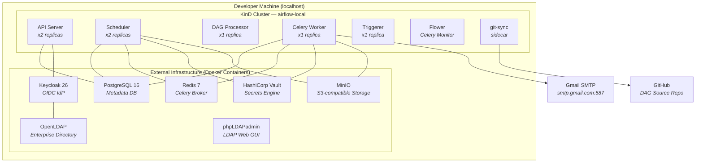
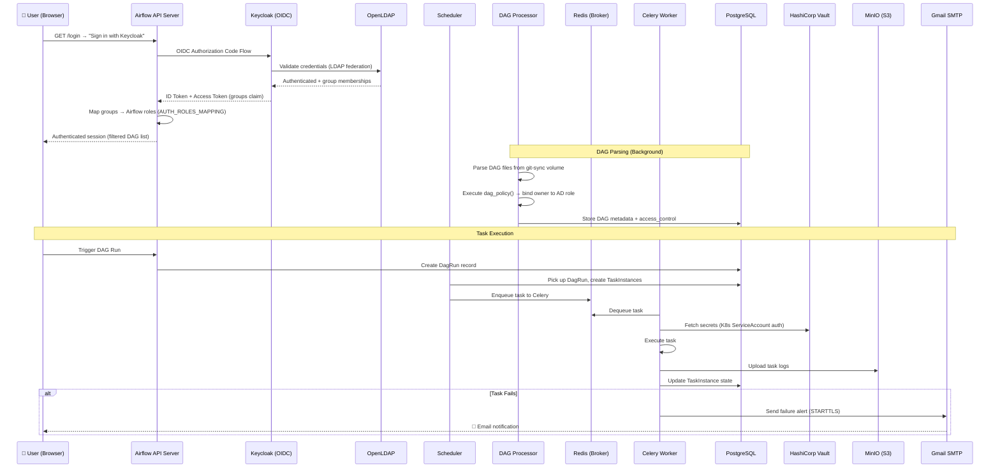
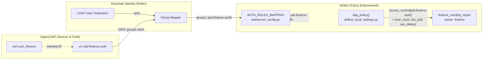

# Apache Airflow 3 — Enterprise Kubernetes Lab

> Production-grade **Apache Airflow 3.3.2** running on local Kubernetes (**KinD**),
> wired to a full enterprise security & infrastructure stack:
> **OpenLDAP → Keycloak OIDC SSO → Dynamic Owner-Based RBAC**,
> **HashiCorp Vault** secrets management, **MinIO S3** remote logging,
> external **PostgreSQL 16** + **Redis 7**, and **Gmail SMTP** failure alerts.

Everything runs locally with a single command — no cloud accounts required.

---

## Table of Contents

- [Architecture Overview](#architecture-overview)
  - [High-Level Topology](#high-level-topology)
  - [Compute Layer (KinD Cluster)](#compute-layer-kind-cluster)
  - [External Infrastructure (Docker Containers)](#external-infrastructure-docker-containers)
  - [Data & Request Flow](#data--request-flow)
- [RBAC Architecture — Owner-Based Dynamic Access Control](#rbac-architecture--owner-based-dynamic-access-control)
  - [The Identity Chain: LDAP → Keycloak → Airflow](#the-identity-chain-ldap--keycloak--airflow)
  - [How It Works End-to-End](#how-it-works-end-to-end)
  - [DAG Authoring Convention](#dag-authoring-convention)
- [Secrets Management — HashiCorp Vault](#secrets-management--hashicorp-vault)
- [Remote Logging — MinIO S3](#remote-logging--minio-s3)
- [Failure Alerting — Gmail SMTP](#failure-alerting--gmail-smtp)
- [Prerequisites](#prerequisites)
- [Quick Start](#quick-start)
- [Access Endpoints & Credentials](#access-endpoints--credentials)
- [CLI Reference (`./ctl`)](#cli-reference-ctl)
- [Project Structure](#project-structure)
- [DAG Development Rules](#dag-development-rules)
- [Troubleshooting](#troubleshooting)

---

## Architecture Overview

The lab mirrors an enterprise deployment pattern where **stateful infrastructure
services live outside the compute cluster** and are bridged in via headless
Kubernetes Services + Endpoints. Airflow's compute workloads (scheduler, workers,
API server, DAG processor, triggerer) run inside a KinD cluster, while databases,
brokers, identity providers, and secret stores run as standalone Docker containers.

### High-Level Topology



### Compute Layer (KinD Cluster)

All Airflow components run inside the `airflow-local` KinD cluster, deployed via
the official [Apache Airflow Helm chart](https://airflow.apache.org/docs/helm-chart/stable/index.html)
with custom `values.yaml` overrides.

| Component | Replicas | Role |
|:---|:---:|:---|
| **API Server** | 2 | Airflow 3 FastAPI/Uvicorn UI & REST API, serves the web interface |
| **Scheduler** | 2 | Parses DAGs, schedules task instances, manages the DAG run lifecycle |
| **DAG Processor** | 1 | Standalone process that parses DAG files and applies `dag_policy` cluster policies |
| **Celery Worker** | 1 | Executes task instances received from the Redis broker |
| **Triggerer** | 1 | Monitors deferred tasks with async sensors and triggers |
| **Flower** | 1 | Real-time Celery monitoring dashboard |
| **git-sync** | sidecar | Pulls DAG files from GitHub every 30 seconds via SSH |

All components have **resource limits**, **PodDisruptionBudgets**, and
**NetworkPolicies** configured. The API Server is exposed via `NodePort 30080`,
mapped to `localhost:8080` through the KinD port mapping.

### External Infrastructure (Docker Containers)

These services run as standalone Docker containers on the host machine, connected
to the KinD `kind` network. Each is bridged into the cluster via a headless
Kubernetes Service with a static Endpoints resource pointing to `172.18.0.1`
(the KinD gateway IP).

| Service | Image | Host Port | In-Cluster DNS | Purpose |
|:---|:---|:---:|:---|:---|
| **PostgreSQL 16** | `postgres:16-alpine` | `5432` | `postgres.airflow.svc.cluster.local:5432` | Airflow metadata database |
| **Redis 7** | `redis:7-alpine` | `6379` | `redis.airflow.svc.cluster.local:6379` | Celery task broker |
| **Keycloak 26** | `quay.io/keycloak/keycloak:26.0.0` | `8081` | `keycloak.airflow.svc.cluster.local:8080` | OpenID Connect Identity Provider |
| **OpenLDAP** | `osixia/openldap:1.5.0` | `389` | `openldap.airflow.svc.cluster.local:389` | Enterprise directory (users & AD groups) |
| **phpLDAPadmin** | `osixia/phpldapadmin:0.9.0` | `8082` | — | Web GUI for LDAP management |
| **HashiCorp Vault** | `hashicorp/vault:1.15.6` | `8200` | `vault.airflow.svc.cluster.local:8200` | Secrets engine (KV v2, K8s Auth) |
| **MinIO** | `cleanstart/minio:latest` | `9000`/`9001` | `s3.airflow.svc.cluster.local:9000` | S3-compatible object storage for logs |

### Data & Request Flow



---

## RBAC Architecture — Owner-Based Dynamic Access Control

The RBAC system achieves **complete DAG isolation** between teams without
requiring DAG authors to hardcode any permissions. It uses a three-tier identity
chain.

### The Identity Chain: LDAP → Keycloak → Airflow



| Layer | Component | Responsibility |
|:---|:---|:---|
| **Directory** | OpenLDAP | Stores users and AD security groups (`aid-<keyword>-auth`) |
| **Identity Broker** | Keycloak | Federates LDAP users, issues OIDC tokens with `groups` claim |
| **Auth Gateway** | `webserver_config.py` | Maps OIDC `groups` claim to Airflow roles via `AUTH_ROLES_MAPPING` |
| **Policy Engine** | `airflow_local_settings.py` | `dag_policy()` extracts `owner` from DAG, builds `aid-<owner>-auth`, sets `access_control` |

### How It Works End-to-End

1. **LDAP defines the truth**: `user_finance` belongs to group `aid-finance-auth`
2. **Keycloak federates**: Syncs users/groups from LDAP, includes `groups` in OIDC tokens
3. **Airflow maps roles at login**: `AUTH_ROLES_MAPPING` converts `aid-finance-auth` → Airflow role `aid-finance-auth`
4. **DAG Processor applies policy**: `dag_policy()` reads `owner="finance"` from the DAG, constructs `aid-finance-auth`, grants `{can_read, can_edit, can_delete}`
5. **Result**: `user_finance` sees **only** `finance_monthly_report`. All other DAGs are invisible.

### DAG Authoring Convention

> [!IMPORTANT]
> DAG developers **never hardcode `access_control`** in DAG files.
> All permission binding is dynamic via the `owner` keyword.

The naming convention for AD groups is: **`aid-<keyword>-auth`**

```python
# dags/finance/finance_report.py
with DAG(
    dag_id="finance_monthly_report",
    default_args={"owner": "finance"},   # ← "finance" maps to "aid-finance-auth"
    tags=["finance", "reporting"],
    ...
):
```

| Owner keyword | AD Group (auto-derived) | Users with access |
|:---|:---|:---|
| `finance` | `aid-finance-auth` | `user_finance`, `alice` (admin) |
| `marketing` | `aid-marketing-auth` | `user_marketing`, `alice` (admin) |
| `logistics` | `aid-logistics-auth` | `user_logistics`, `alice` (admin) |
| `analytics` | `aid-analytics-auth` | `user_analytics`, `alice` (admin) |

---

## Secrets Management — HashiCorp Vault

Vault runs in **dev mode** as an external container, connected to the KinD cluster
via Kubernetes Auth method (zero-secret, ServiceAccount-based authentication).

```
secret/data/airflow/
├── variables/
│   ├── keycloak_admin_password
│   ├── keycloak_client_secret
│   ├── breakglass_password
│   └── alert_recipient
├── config/
│   ├── core/fernet_key
│   ├── webserver/secret_key
│   └── api/secret_key
└── connections/
    ├── postgres_default
    ├── smtp_default
    └── aws_default
```

Airflow accesses Vault via the `VaultBackend` secrets backend, configured in
`values.yaml` under `config.secrets`. Pods authenticate using their Kubernetes
ServiceAccount token — no static tokens or passwords are injected.

---

## Remote Logging — MinIO S3

Task execution logs are shipped to MinIO (S3-compatible object storage) via the
`apache-airflow-providers-amazon` provider. Configuration in `values.yaml`:

| Setting | Value |
|:---|:---|
| `remote_logging` | `True` |
| `remote_log_conn_id` | `aws_default` (points to MinIO) |
| `remote_base_log_folder` | `s3://airflow-logs` |
| MinIO endpoint | `http://s3.airflow.svc.cluster.local:9000` |

---

## Failure Alerting — Gmail SMTP

When a task fails, Airflow sends an email notification via Gmail SMTP (STARTTLS
on port 587). The alert includes the DAG name, task ID, attempt number, and a
link to the task log. Custom HTML/text templates are baked into the Docker image
at `/opt/airflow/config/email/`.

> [!NOTE]
> A 16-character Google App Password is required. The startup script prompts for
> it interactively or reads from the `GMAIL_APP_PASSWORD` environment variable.

---

## Prerequisites

| Tool | Version | Purpose |
|:---|:---|:---|
| [Docker](https://docs.docker.com/get-docker/) | ≥ 24.x | Container runtime for KinD + external services |
| [KinD](https://kind.sigs.k8s.io/) | ≥ 0.20 | Local Kubernetes clusters in Docker |
| [kubectl](https://kubernetes.io/docs/tasks/tools/) | ≥ 1.28 | Kubernetes CLI |
| [Helm](https://helm.sh/docs/intro/install/) | ≥ 3.14 | Kubernetes package manager |
| [Python 3](https://www.python.org/) | ≥ 3.10 | Used by `./ctl test-auth` and Vault seed scripts |
| [jq](https://jqlang.github.io/jq/) | ≥ 1.6 | JSON processing in LDAP sync commands |
| [curl](https://curl.se/) | any | Health checks in setup scripts |

---

## Quick Start

```bash
# 1. Clone the repository
git clone git@github.com:your-org/airflow-enterprise-lab.git
cd Learn_Airflow

# 2. One command to launch everything
./ctl start
# ↳ Creates KinD cluster
# ↳ Builds custom Airflow Docker image
# ↳ Starts OpenLDAP + phpLDAPadmin + Keycloak + PostgreSQL + Redis + Vault + MinIO
# ↳ Bridges all external services into the cluster via K8s Services/Endpoints
# ↳ Deploys Airflow via Helm chart
# ↳ Seeds AD group roles and base permissions into Airflow DB

# 3. Check everything is healthy
./ctl status

# 4. Open Airflow and log in with Keycloak SSO
#    → http://localhost:8080 → Click "Sign in with keycloak"

# 5. Tear down when done
./ctl stop
```

---

## Access Endpoints & Credentials

### Service Endpoints

| Service | URL | Notes |
|:---|:---|:---|
| **Airflow Web UI** | [http://localhost:8080](http://localhost:8080) | Click "Sign in with keycloak" |
| **Keycloak Admin** | [http://localhost:8081](http://localhost:8081) | Realm: `airflow` |
| **phpLDAPadmin** | [http://localhost:8082](http://localhost:8082) | LDAP Web GUI |
| **HashiCorp Vault** | [http://localhost:8200](http://localhost:8200) | K8s ServiceAccount Auth |
| **MinIO Console** | [http://localhost:9001](http://localhost:9001) | S3 Object Browser |
| **Flower** | [http://localhost:5555](http://localhost:5555) | Celery Monitoring |

### User Credentials

| User | Password | Group | DAG Access |
|:---|:---|:---|:---|
| `alice` | `Alice-lab-1` | `airflow-admins` | **All DAGs** (Super Admin) |
| `user_finance` | `Finance-lab-1` | `aid-finance-auth` | `finance_monthly_report` |
| `user_marketing` | `Marketing-lab-1` | `aid-marketing-auth` | `marketing_campaign_tracker` |
| `user_logistics` | `Logistics-lab-1` | `aid-logistics-auth` | `logistics_fleet_monitoring` |
| `user_analytics` | `Analytics-lab-1` | `aid-analytics-auth` | `analytics_daily_etl` |

### Admin Credentials

| Service | User | Password |
|:---|:---|:---|
| Keycloak Admin Console | `admin` | `admin` |
| phpLDAPadmin | `cn=admin,dc=example,dc=org` | `admin` |
| MinIO Console | `minioadmin` | `minioadmin` |
| Break-glass Airflow Admin | `breakglass` | Managed via K8s secret `airflow-breakglass-secret` |

> [!CAUTION]
> The break-glass admin bypasses SSO and authenticates directly against the
> Airflow database. Use it only for emergency recovery when Keycloak is unavailable.

---

## CLI Reference (`./ctl`)

The `ctl` script is a portable, dependency-free bash CLI that manages the entire
lab lifecycle.

| Command | Description |
|:---|:---|
| `./ctl start` | Create KinD cluster, build image, start all infra, deploy Airflow |
| `./ctl stop` | Delete KinD cluster and stop all external Docker containers |
| `./ctl status` | Show pod health, external container status, endpoints, and credentials |
| `./ctl build` | Rebuild the custom Airflow Docker image |
| `./ctl test-alert` | Trigger the failure notification DAG and verify Gmail delivery |
| `./ctl test-auth` | Test Keycloak OIDC token issuance for all team users |
| `./ctl logs <target>` | Tail logs for `worker`, `scheduler`, or `keycloak` |
| `./ctl vault status` | Check Vault container health |
| `./ctl vault ui` | Print Vault Web UI URL and root token |
| `./ctl vault start` | Start Vault and seed initial secrets |
| `./ctl ldap status` | Show OpenLDAP and phpLDAPadmin container status |
| `./ctl ldap ui` | Print phpLDAPadmin URL and login DN |
| `./ctl ldap list-users` | List all users in the LDAP directory |
| `./ctl ldap list-groups` | List all AD groups and their members |
| `./ctl ldap add-user` | Create a new LDAP user and add to an AD group |
| `./ctl ldap sync` | Trigger Keycloak full LDAP sync |

A `Makefile` wrapper is also available for common commands (`make start`,
`make stop`, `make status`, `make build`, `make test-alert`, `make test-auth`).

---

## Project Structure

```text
.
├── ctl                                  # Portable CLI — manages full lab lifecycle
├── Makefile                             # Make wrapper for CI/CD-friendly commands
├── Dockerfile                           # Multi-stage Airflow 3 image (slim base + LDAP/auth deps)
├── requirements.txt                     # Python deps: celery, fab, postgres, redis, smtp, ldap, vault, s3
├── values.yaml                          # Helm chart values — executor, secrets, SMTP, git-sync, resources
│
├── constraints/
│   └── constraints-3.12.txt             # Pinned pip constraints for deterministic Python 3.12 builds
│
├── config/
│   ├── airflow_local_settings.py        # dag_policy() — dynamic owner-based RBAC cluster policy
│   ├── webserver_config.py              # Flask-AppBuilder OAuth — Keycloak OIDC provider + role mapping
│   └── email/
│       ├── content.html                 # Jinja2 HTML template for failure alert emails
│       └── subject.txt                  # Jinja2 subject line template
│
├── dags/
│   ├── analytics/
│   │   └── analytics_etl.py             # Analytics ETL pipeline (owner: analytics)
│   ├── finance/
│   │   └── finance_report.py            # Finance monthly report (owner: finance)
│   ├── logistics/
│   │   └── logistics_delivery.py        # Logistics fleet monitoring (owner: logistics)
│   └── marketing/
│       └── marketing_campaign.py        # Marketing campaign tracker (owner: marketing)
│
├── k8s/
│   ├── kind-cluster.yaml                # KinD config — NodePort mappings (8080, 5555)
│   ├── keycloak/
│   │   ├── deployment.yaml              # Keycloak K8s Deployment + Service (NodePort 30081)
│   │   ├── service.yaml                 # Headless Service + Endpoints bridging external Keycloak
│   │   └── realm-airflow.json           # Pre-built realm export: clients, roles, mappers, users
│   ├── ldap/
│   │   ├── bootstrap.ldif               # LDAP seed data: OUs, users, AD security groups
│   │   └── service.yaml                 # Headless Service + Endpoints bridging external OpenLDAP
│   ├── postgres/
│   │   └── service.yaml                 # Headless Service + Endpoints bridging external PostgreSQL
│   ├── redis/
│   │   └── service.yaml                 # Headless Service + Endpoints bridging external Redis
│   ├── vault/
│   │   └── service.yaml                 # Headless Service + Endpoints bridging external Vault
│   └── s3/
│       └── service.yaml                 # Headless Service + Endpoints bridging external MinIO
│
├── scripts/
│   ├── start-local-k8s.sh               # Master orchestrator — KinD + image build + all infra + Helm
│   ├── stop-local-k8s.sh                # Cluster deletion + external container shutdown
│   ├── setup-ldap.sh                    # OpenLDAP + phpLDAPadmin provisioning + LDIF seeding
│   ├── setup-keycloak.sh                # Keycloak provisioning + realm import + K8s bridge
│   ├── setup-db-redis.sh                # PostgreSQL 16 + Redis 7 provisioning + K8s secrets
│   ├── setup-vault.sh                   # Vault provisioning + K8s Auth + secret seeding
│   └── setup-s3.sh                      # MinIO provisioning + K8s bridge
│
└── plugins/                             # (Reserved) Airflow plugin directory
```

---

## DAG Development Rules

> [!WARNING]
> These rules are enforced across the repository. Violating them will break
> the RBAC model or cause DAG parsing failures.

1. **No `@dag` or `@task` decorators** — Do not use the TaskFlow API. Always use
   explicit Operator classes (`PythonOperator`, `BashOperator`, etc.)
2. **Context manager syntax** — Define DAGs with `with DAG(...) as dag:`
3. **Explicit dependencies** — Chain tasks using bitshift operators (`task1 >> task2`)
4. **Owner keyword** — Set `default_args={"owner": "<keyword>"}` to match your
   team's AD group (`aid-<keyword>-auth`)
5. **No hardcoded `access_control`** — Permissions are applied dynamically by
   `dag_policy()` in the cluster policy
6. **Tags** — Use `tags=["<keyword>"]` for additional categorization (tags
   matching `aid-*-auth` or known keywords are also auto-mapped by the policy)

---

## Troubleshooting

<details>
<summary><strong>Pods stuck in CrashLoopBackOff</strong></summary>

Check logs for the failing pod:
```bash
kubectl logs -n airflow <pod-name> -c <container> --tail=100
```
Common causes:
- PostgreSQL or Redis not reachable (external container stopped)
- Vault secret sync failed (check `airflow-api-secret` exists)
- Docker image not loaded into KinD (`kind load docker-image ...`)
</details>

<details>
<summary><strong>Keycloak login redirects fail or loop</strong></summary>

Ensure Keycloak is healthy:
```bash
curl -s http://localhost:8081/realms/airflow/.well-known/openid-configuration | jq .issuer
```
The `KEYCLOAK_INTERNAL_URL` env var must resolve inside the cluster. Check the
`keycloak` headless Service and Endpoints:
```bash
kubectl get endpoints keycloak -n airflow
```
</details>

<details>
<summary><strong>User sees no DAGs after Keycloak login</strong></summary>

1. Verify the user's LDAP group membership: `./ctl ldap list-groups`
2. Verify Keycloak synced the groups: `./ctl test-auth`
3. Check that AD team roles exist in Airflow: `kubectl exec -n airflow deploy/airflow-scheduler -c scheduler -- airflow roles list`
4. Ensure the DAG has the correct `owner` in `default_args`
</details>

<details>
<summary><strong>Gmail alerts not sending</strong></summary>

1. Verify the SMTP secret exists:
   ```bash
   kubectl get secret airflow-smtp-secret -n airflow
   ```
2. Test with a real 16-char Google App Password (not the placeholder)
3. Check worker logs for SMTP errors: `./ctl logs worker`
</details>

<details>
<summary><strong>Vault connection errors in scheduler/worker logs</strong></summary>

1. Check Vault health: `./ctl vault status`
2. Verify Vault is on the KinD network: `docker network inspect kind`
3. Check the `vault` Service and Endpoints in Kubernetes:
   ```bash
   kubectl get endpoints vault -n airflow
   ```
</details>

---

## License

This project is for educational and lab purposes.
