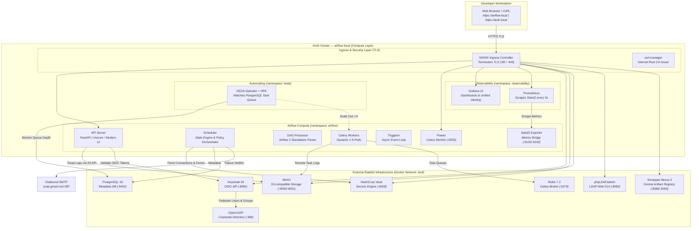
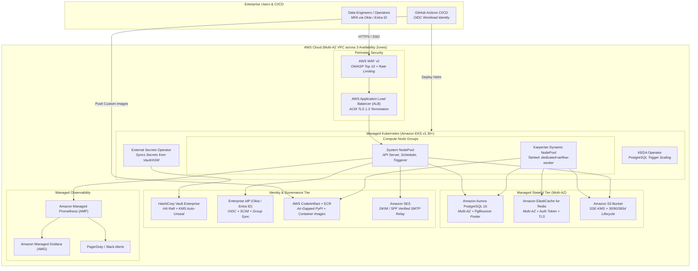
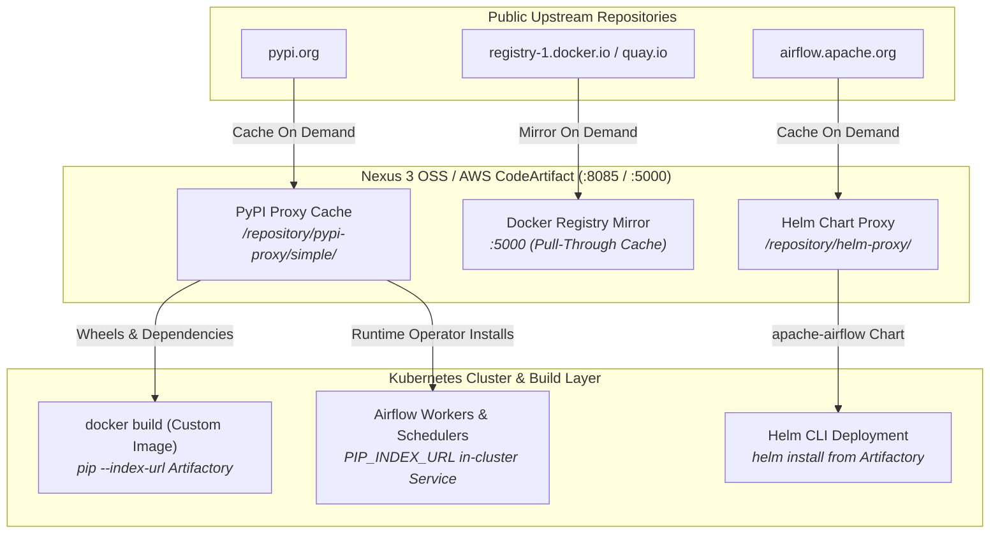
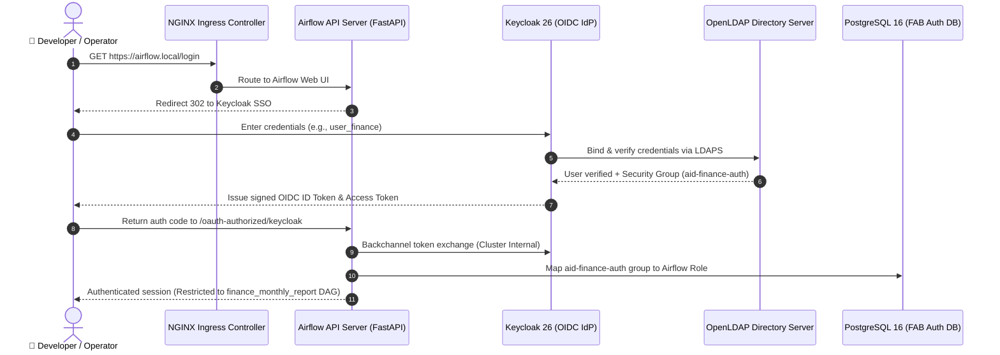

# Apache Airflow 3 — Enterprise Kubernetes Reference Architecture & Production Blueprint

[](https://airflow.apache.org/)
[](https://www.keycloak.org/)
[](https://kind.sigs.k8s.io/)
[](https://www.vaultproject.io/)
[](https://min.io/)
[](https://www.sonatype.com/products/sonatype-nexus-oss)
[](https://keda.sh/)
[](https://grafana.com/)

A battle-tested, production-grade reference architecture, deployment manual, and operational runbook for **Apache Airflow 3.3.2** running on Kubernetes. This repository delivers:
1. **Zero-Cloud-Cost Local Kubernetes Lab (KinD)**: Spins up a complete enterprise infrastructure perimeter with a single command (SSO, LDAP, Vault secrets, S3 storage, air-gapped Nexus repository, KEDA autoscaling, and Prometheus/Grafana observability).
2. **Production Tooling Mapping & Configuration Guide**: Detailed analysis comparing each local container to enterprise equivalents across AWS, GCP, Azure, and On-Premise environments, with exact production configuration parameters.
3. **Step-by-Step From-Scratch Deployment Runbooks**: Complete guides for launching the environment locally and executing a multi-phase enterprise cloud deployment.

---

## Table of Contents

- [1. System Architecture & Topology](#1-system-architecture--topology)
  - [Local Lab Topology (KinD + External Containers)](#local-lab-topology-kind--external-containers)
  - [Enterprise Production Cloud Architecture (AWS EKS Multi-AZ)](#enterprise-production-cloud-architecture-aws-eks-multi-az)
  - [Air-Gapped Artifact Flow (Nexus / Artifactory)](#air-gapped-artifact-flow-nexus--artifactory)
  - [SSO & Multi-Tenant Dynamic RBAC Authentication Sequence](#sso--multi-tenant-dynamic-rbac-authentication-sequence)
- [2. Enterprise Production vs. Local Tooling Matrix](#2-enterprise-production-vs-local-tooling-matrix)
  - [Master Tooling Comparison Matrix](#master-tooling-comparison-matrix)
  - [Component-by-Component Production Configuration Blueprints](#component-by-component-production-configuration-blueprints)
    - [1. Compute & Kubernetes Orchestration](#1-compute--kubernetes-orchestration)
    - [2. Identity & Single Sign-On (SSO)](#2-identity--single-sign-on-sso)
    - [3. Corporate Directory Services (LDAP/AD)](#3-corporate-directory-services-ldapad)
    - [4. External Secrets Management](#4-external-secrets-management)
    - [5. Remote Object Storage (Task Logs & Assets)](#5-remote-object-storage-task-logs--assets)
    - [6. Central Artifact Registry & Dependency Proxy](#6-central-artifact-registry--dependency-proxy)
    - [7. Metadata Database & Connection Pooling](#7-metadata-database--connection-pooling)
    - [8. Task Queue & Message Broker](#8-task-queue--message-broker)
    - [9. Ingress, TLS Termination & Web Application Firewall (WAF)](#9-ingress-tls-termination--web-application-firewall-waf)
    - [10. Event-Driven Worker Autoscaling](#10-event-driven-worker-autoscaling)
    - [11. Observability, Telemetry & PagerDuty Alerting](#11-observability-telemetry--pagerduty-alerting)
    - [12. Pipeline Failure Email Notifications](#12-pipeline-failure-email-notifications)
    - [13. DAG Delivery & Synchronization](#13-dag-delivery--synchronization)
- [3. Unified Access Endpoints & Enterprise Personas Directory](#3-unified-access-endpoints--enterprise-personas-directory)
  - [Web UIs & Service Consoles](#web-uis--service-consoles)
  - [Enterprise User Persona & RBAC Authorization Matrix](#enterprise-user-persona--rbac-authorization-matrix)
- [4. Step-by-Step Local Deployment Guide (From Scratch)](#4-step-by-step-local-deployment-guide-from-scratch)
  - [Hardware & Operating System Requirements](#hardware--operating-system-requirements)
  - [Step 1: Install Host Prerequisites](#step-1-install-host-prerequisites)
  - [Step 2: Clone the Repository](#step-2-clone-the-repository)
  - [Step 3: Environment Setup & Notification Credentials](#step-3-environment-setup--notification-credentials)
  - [Step 4: Launch the Lab Environment](#step-4-launch-the-lab-environment)
  - [Step 5: Configure Local DNS Records (`/etc/hosts`)](#step-5-configure-local-dns-records-etchosts)
  - [Step 6: End-to-End Verification & Smoke Testing](#step-6-end-to-end-verification--smoke-testing)
  - [Step 7: Day-to-Day Local Operations](#step-7-day-to-day-local-operations)
- [5. Step-by-Step Enterprise Production Deployment Blueprint (From Scratch)](#5-step-by-step-enterprise-production-deployment-blueprint-from-scratch)
  - [Phase 1: Cloud Network Foundation (Multi-AZ VPC)](#phase-1-cloud-network-foundation-multi-az-vpc)
  - [Phase 2: Managed Kubernetes Cluster Provisioning (EKS)](#phase-2-managed-kubernetes-cluster-provisioning-eks)
  - [Phase 3: Production Metadata DB & PgBouncer Setup](#phase-3-production-metadata-db--pgbouncer-setup)
  - [Phase 4: Message Broker & Cache Provisioning (ElastiCache)](#phase-4-message-broker--cache-provisioning-elasticache)
  - [Phase 5: Cloud Object Storage & Log Retention Lifecycle (S3)](#phase-5-cloud-object-storage--log-retention-lifecycle-s3)
  - [Phase 6: Enterprise Identity Provider & SSO Federation](#phase-6-enterprise-identity-provider--sso-federation)
  - [Phase 7: Enterprise Secrets Management & Key Rotation (Vault / ESO)](#phase-7-enterprise-secrets-management--key-rotation-vault--eso)
  - [Phase 8: Private Container Registry & CI/CD Quality Gates](#phase-8-private-container-registry--cicd-quality-gates)
  - [Phase 9: Ingress, TLS, WAF & DNS Architecture](#phase-9-ingress-tls-waf--dns-architecture)
  - [Phase 10: Production Helm Chart Deployment (`values.prod.yaml`)](#phase-10-production-helm-chart-deployment-valuesprodyaml)
  - [Phase 11: Event-Driven Worker Autoscaling (KEDA + Karpenter)](#phase-11-event-driven-worker-autoscaling-keda--karpenter)
  - [Phase 12: Production Observability, Dashboards & Alerting](#phase-12-production-observability-dashboards--alerting)
  - [Phase 13: Day-2 Operations, Governance & Disaster Recovery](#phase-13-day-2-operations-governance--disaster-recovery)
- [6. Core Architecture Deep-Dives](#6-core-architecture-deep-dives)
  - [A. Dynamic Owner-Based RBAC (`airflow_local_settings.py`)](#a-dynamic-owner-based-rbac-airflow_local_settingspy)
  - [B. Enterprise SSO & Backchannel Resolution](#b-enterprise-sso--backchannel-resolution)
  - [C. Central Artifact Repository Architecture (Nexus 3 OSS)](#c-central-artifact-repository-architecture-nexus-3-oss)
  - [D. External Secrets Backend Integration (Vault)](#d-external-secrets-backend-integration-vault)
  - [E. Event-Driven Autoscaling with KEDA](#e-event-driven-autoscaling-with-keda)
- [7. Portable Control CLI Reference (`./ctl`)](#7-portable-control-cli-reference-ctl)
- [8. DAG Authoring Standards & Quality Gates](#8-dag-authoring-standards--quality-gates)
- [9. Complete Repository Structure](#9-complete-repository-structure)
- [10. Troubleshooting & FAQ](#10-troubleshooting--faq)

---

## 1. System Architecture & Topology

### Local Lab Topology (KinD + External Containers)

The local lab runs an in-cluster compute layer paired with stateful external containers on the host Docker bridge (`172.18.0.1`), exposed via Kubernetes headless Services and Endpoints:



---

### Enterprise Production Cloud Architecture (AWS EKS Multi-AZ)

In production, each local container is mapped to a fully managed, multi-AZ cloud service with dedicated security perimeters:



---

### Air-Gapped Artifact Flow (Nexus / Artifactory)

To guarantee build reproducibility, security compliance, and zero exposure to external PyPI downtime:



---

### SSO & Multi-Tenant Dynamic RBAC Authentication Sequence



---

## 2. Enterprise Production vs. Local Tooling Matrix

### Master Tooling Comparison Matrix

The table below provides a 1-to-1 mapping from the local lab tools used in this repository to their production-grade counterparts in AWS, GCP, Azure, and On-Premise environments:

| Architecture Layer | Local Lab Tool | Production Equivalent (AWS) | Production Equivalent (GCP) | Production Equivalent (Azure) | On-Premise Enterprise Equivalent | Production Configuration Focus & Why |
| :--- | :--- | :--- | :--- | :--- | :--- | :--- |
| **Compute / Kubernetes** | **KinD** (Kubernetes in Docker v1.30) | **Amazon EKS** + Karpenter | **Google Kubernetes Engine (GKE)** | **Azure Kubernetes Service (AKS)** | **Red Hat OpenShift** / Rancher RKE2 | Multi-AZ worker nodes, dedicated nodepools for Celery workers with taints, PodDisruptionBudgets, cluster autoscaling. |
| **Identity & SSO** | **Keycloak 26** (Standalone Container) | **Keycloak HA on EKS** or **Okta / AWS IAM Identity Center** | **Google Cloud Identity** / Okta | **Microsoft Entra ID (Azure AD)** | **PingFederate** / Keycloak HA (Infinispan) | Multi-AZ cluster, custom token claims, federated group synchronization, MFA enforcement, backchannel token exchange. |
| **Directory Services** | **OpenLDAP** + phpLDAPadmin | **AWS Directory Service** (Managed Microsoft AD) | **Google Cloud Directory Sync** | **Microsoft Entra Domain Services** | **Corporate Active Directory (AD DS)** / FreeIPA | LDAPS (port 636) with enterprise CA certificates, nested security groups, read-only domain controllers. |
| **Secrets Engine** | **HashiCorp Vault** (Dev Container) | **HashiCorp Vault Enterprise** (HA Raft) or **AWS Secrets Manager** | **GCP Secret Manager** / Vault | **Azure Key Vault** / Vault | **Vault Enterprise** with HSM integration | Auto-unseal via Cloud KMS, dynamic short-lived DB credentials, automated Fernet key rotation, External Secrets Operator (ESO). |
| **Remote Object Storage** | **MinIO** (S3 Emulator) | **Amazon S3** (Standard + Glacier) | **Google Cloud Storage (GCS)** | **Azure Blob Storage** | **Dell ECS** / Ceph Object Gateway | SSE-KMS bucket encryption, 30/90/365-day lifecycle tiering, S3 Versioning, cross-region replication (CRR), IRSA zero-static keys. |
| **Artifact / Package Cache** | **Sonatype Nexus 3 OSS** (Local Container) | **AWS CodeArtifact** + **Amazon ECR** or **JFrog Artifactory** | **GCP Artifact Registry** | **Azure Artifacts** + **ACR** | **JFrog Artifactory Enterprise** / Harbor | Air-gapped PyPI proxy cache, immutable container image tags, automated CVE vulnerability scanning (Trivy/Clair/Inspector). |
| **Metadata Database** | **PostgreSQL 16** (Container) | **Amazon Aurora PostgreSQL** (Multi-AZ Serverless v2) | **Cloud SQL for PostgreSQL** (HA) | **Azure Database for PostgreSQL Flexible** | **PostgreSQL with Patroni** / Crunchy Data PGO | PgBouncer connection pooling (required for large worker pools), automated daily snapshots, Point-In-Time-Recovery (PITR). |
| **Task Queue / Broker** | **Redis 7.2** (Container) | **Amazon ElastiCache for Redis / Valkey** (Multi-AZ) | **Cloud Memorystore for Redis** | **Azure Cache for Redis** | **Redis Enterprise Cluster** | Multi-AZ replication with automatic failover, in-transit encryption (TLS), auth token authentication. |
| **Ingress & TLS** | **NGINX Ingress** + cert-manager CA | **AWS Load Balancer Controller (ALB)** + **ACM** | **GKE Ingress** + Cloud SSL | **Azure Application Gateway (AGIC)** | **F5 BIG-IP** / NGINX Plus + Corporate PKI | Layer 7 Web Application Firewall (AWS WAF), DDoS mitigation, automated TLS certificate renewal. |
| **Worker Autoscaling** | **KEDA 2.14** (PostgreSQL Scaler) | **KEDA** + **Karpenter** (Node Provisioner) | **KEDA** + GKE Autoscaler | **KEDA** + AKS Autoscaler | **KEDA** + Cluster Autoscaler | Event-driven pod autoscaling based on task queue depth (`task_instance`), paired with instant cloud node provisioning (<45s). |
| **Observability** | **Prometheus + Grafana 11** | **Amazon Managed Prometheus (AMP)** + **Managed Grafana (AMG)** | **Google Cloud Managed Service for Prometheus** | **Azure Monitor Prometheus** | **VictoriaMetrics** / Thanos + Grafana Enterprise | Long-term metric storage in S3, custom Airflow dashboards, PagerDuty, OpsGenie, and Slack alerting. |
| **Failure Alerting** | **Gmail SMTP** (STARTTLS) | **Amazon Simple Email Service (SES)** | **SendGrid** / Mailgun | **Azure Communication Services** | **Corporate Exchange Relay** / Postfix | Dedicated IP pools, SPF / DKIM / DMARC verification, bounce tracking webhooks, Vault-managed SMTP credentials. |
| **DAG Delivery** | **Host Bind-Mount / git-sync** | **Immutable Container Image Baking** (CI/CD) or **git-sync sidecar** | **Image Baking** / Cloud Storage FUSE | **Image Baking** / Azure Files | **Image Baking** / Enterprise NFS | Immutable deployments prevent mid-execution DAG drift, enforce strict CI/CD quality gates, and eliminate runtime Git tokens. |

---

### Component-by-Component Production Configuration Blueprints

#### 1. Compute & Kubernetes Orchestration
- **Local Lab Setup**: KinD cluster provisioned with port mappings `80:80`, `443:443`, `8080:30080`, `5555:30555` to simulate NodePort and Ingress routing locally.
- **Enterprise Production Architecture**:
  - Deploy **Amazon EKS** (v1.30+) across 3 private subnets in distinct Availability Zones.
  - Implement two distinct nodepools:
    1. **System / Control Plane Nodepool**: General-purpose instances (`m6i.xlarge`) running Airflow Scheduler, API Server, Triggerer, and StatsD.
    2. **Worker Nodepool (Karpenter)**: Compute-optimized dynamic instances (`c6i.2xlarge`, `c7i.2xlarge`) tainted to isolate heavy pipeline execution:
  ```yaml
  apiVersion: karpenter.sh/v1beta1
  kind: NodePool
  metadata:
    name: airflow-celery-workers
  spec:
    template:
      spec:
        requirements:
          - key: "karpenter.k8s.aws/instance-family"
            operator: In
            values: ["c6i", "c7i", "m6i"]
          - key: "karpenter.sh/capacity-type"
            operator: In
            values: ["on-demand", "spot"]
        taints:
          - key: dedicated
            value: airflow-worker
            effect: NoSchedule
  ```
  - In [`values.yaml`](values.yaml), configure matching tolerations and affinities:
  ```yaml
  workers:
    tolerations:
      - key: "dedicated"
        operator: "Equal"
        value: "airflow-worker"
        effect: "NoSchedule"
    affinity:
      nodeAffinity:
        requiredDuringSchedulingIgnoredDuringExecution:
          nodeSelectorTerms:
            - matchExpressions:
                - key: "karpenter.sh/nodepool"
                  operator: In
                  values: ["airflow-celery-workers"]
  ```

---

#### 2. Identity & Single Sign-On (SSO)
- **Local Lab Setup**: Keycloak 26 container running in dev mode on port `8081` with realm `airflow` and federated OpenLDAP provider.
- **Enterprise Production Architecture**:
  - Integrate directly with **Okta** or **Microsoft Entra ID (Azure AD)**, OR deploy **Keycloak HA** on Kubernetes with Infinispan distributed caching across 3 replicas backed by Aurora PostgreSQL.
  - Configure OIDC parameters in [`config/webserver_config.py`](config/webserver_config.py):
    - Client ID and Client Secret injected via Kubernetes Secret from Vault.
    - Scopes requested: `openid`, `email`, `profile`, `groups`.
    - Custom JWT Claim Mapper: Map Active Directory security groups into token claim `"groups"`.
    - Airflow Role Mapping:
      ```python
      AUTH_ROLES_MAPPING = {
          "aid-airflow-admins": ["Admin"],
          "aid-finance-auth": ["FinanceRole"],
          "aid-analytics-auth": ["AnalyticsRole"],
          "aid-marketing-auth": ["MarketingRole"],
          "aid-logistics-auth": ["LogisticsRole"],
      }
      ```
  - Enable **Dual Hostname Resolution**: Ensure the external browser redirects to `https://auth.company.com/realms/airflow` while cluster-internal token validation connects via private DNS.

---

#### 3. Corporate Directory Services (LDAP/AD)
- **Local Lab Setup**: OpenLDAP container (`osixia/openldap:1.5.0`) seeded with `dc=example,dc=org` and phpLDAPadmin GUI on port `8082`.
- **Enterprise Production Architecture**:
  - Connect Keycloak to **Corporate Active Directory (AD DS)** or **AWS Managed Microsoft AD** via **LDAPS (TCP Port 636)**.
  - Production Security Settings:
    - Trust the enterprise Root CA certificate by mounting it into the Keycloak pod truststore (`/etc/pki/ca-trust/extracted/pem/tls-ca-bundle.pem`).
    - Service Account: Dedicated read-only bind DN (`cn=svc-airflow-idp,ou=ServiceAccounts,dc=company,dc=com`).
    - User Object Classes: `person`, `organizationalPerson`, `user`.
    - Membership Search: Filter groups by `memberOf` with recursive membership enabled for nested security groups.

---

#### 4. External Secrets Management
- **Local Lab Setup**: HashiCorp Vault dev server container on port `8200` with root token authentication.
- **Enterprise Production Architecture**:
  - Deploy **HashiCorp Vault Enterprise** with HA Integrated Storage (Raft) across 3 or 5 nodes, with Cloud KMS Auto-Unseal.
  - Configure the **Airflow Vault Secrets Backend** in [`values.yaml`](values.yaml):
  ```yaml
  config:
    secrets:
      backend: "airflow.providers.hashicorp.secrets.vault.VaultBackend"
      backend_kwargs: >-
        {
          "url": "https://vault.company.internal:8200",
          "auth_type": "kubernetes",
          "kubernetes_role": "airflow-prod",
          "mount_point": "secret",
          "kv_engine_version": 2,
          "variables_path": "airflow/prod/variables",
          "connections_path": "airflow/prod/connections",
          "config_path": "airflow/prod/config"
        }
  ```
  - Alternatively, use the **External Secrets Operator (ESO)** to continuously sync secrets from AWS Secrets Manager or Azure Key Vault directly into native Kubernetes Secrets.
  - **Fernet Key Auto-Rotation**: Store multi-key comma-separated Fernet strings in Vault (`new_key,old_key`) and run `airflow rotate-fernet-key` on a 90-day maintenance cycle.

---

#### 5. Remote Object Storage (Task Logs & Assets)
- **Local Lab Setup**: MinIO container on ports `9000` (API) and `9001` (Console) with bucket `airflow-logs`.
- **Enterprise Production Architecture**:
  - Deploy **Amazon S3** (`s3://company-airflow-logs-prod`) or **Google Cloud Storage (GCS)**.
  - Zero Static Credentials: Use **IAM Roles for Service Accounts (IRSA)**. Airflow worker pods obtain temporary STS tokens automatically.
  - **S3 Lifecycle Tiering Configuration**:
  ```json
  {
    "Rules": [
      {
        "ID": "AirflowLogRetentionLifecycle",
        "Status": "Enabled",
        "Filter": { "Prefix": "dag_id=" },
        "Transitions": [
          { "Days": 30, "StorageClass": "STANDARD_IA" },
          { "Days": 90, "StorageClass": "GLACIER" }
        ],
        "Expiration": { "Days": 365 }
      }
    ]
  }
  ```
  - **Encryption**: Enforce Server-Side Encryption with Customer Managed KMS Keys (`aws:kms`).

---

#### 6. Central Artifact Registry & Dependency Proxy
- **Local Lab Setup**: Sonatype Nexus 3 OSS container on host ports `8085` (UI/API) and `5000` (Docker mirror), auto-configured with PyPI, Helm, and Docker proxies.
- **Enterprise Production Architecture**:
  - Deploy **AWS CodeArtifact** + **Amazon ECR**, or **JFrog Artifactory Enterprise**.
  - Configure private PyPI proxy repositories to cache packages upstream and block compromised packages.
  - Configure immutable image tags in Amazon ECR (`imageTagMutability: IMMUTABLE`).
  - Enable continuous container security scanning with **Trivy** or **Amazon Inspector** to reject images with `CRITICAL` CVEs before deployment.

---

#### 7. Metadata Database & Connection Pooling
- **Local Lab Setup**: PostgreSQL 16 container on port `5432`.
- **Enterprise Production Architecture**:
  - Deploy **Amazon Aurora PostgreSQL 16** (Multi-AZ Serverless v2 or provisioned instances) with automated failover (<30 seconds).
  - **PgBouncer Connection Pooling**: Mandatory for production Celery worker pools. Workers open hundreds of short-lived connections that can exhaust PostgreSQL backend processes.
  ```yaml
  pgbouncer:
    enabled: true
    maxClientConn: 2000
    defaultPoolSize: 100
    poolMode: "transaction"
  ```
  - Database Parameter Tuning:
    - `max_connections = 2000`
    - `shared_buffers = 8GB` (25% of node memory)
    - `work_mem = 64MB`
    - `statement_timeout = 300000` (5 minutes)
  - Backups: Continuous write-ahead log (WAL) archiving with 35-day Point-In-Time-Recovery (PITR).

---

#### 8. Task Queue & Message Broker
- **Local Lab Setup**: Redis 7.2 container on port `6379`.
- **Enterprise Production Architecture**:
  - Deploy **Amazon ElastiCache for Redis (or Valkey)** in Multi-AZ replication group with automatic failover.
  - Enable **In-Transit Encryption (TLS)** and **At-Rest Encryption (KMS)**.
  - Enforce authentication via strong Redis AUTH token.
  - Celery Broker Connection String: `rediss://:<auth-token>@<cluster-endpoint>:6379/0`.

---

#### 9. Ingress, TLS Termination & Web Application Firewall (WAF)
- **Local Lab Setup**: NGINX Ingress Controller terminating TLS using an internal Root CA ClusterIssuer managed by `cert-manager`.
- **Enterprise Production Architecture**:
  - Deploy **AWS Load Balancer Controller (ALB)** with public certificates issued by **AWS Certificate Manager (ACM)**.
  - Attach an **AWS WAF v2 WebACL** to protect the Airflow Web UI from brute-force attacks and web vulnerabilities:
    - Enable `AWSManagedRulesCommonRuleSet`.
    - Enable `AWSManagedRulesKnownBadInputsRuleSet`.
    - Rate limit: Restrict clients to 2,000 requests per 5-minute window.
    - Corporate IP Whitelist: Restrict UI access to enterprise VPN CIDR blocks.

---

#### 10. Event-Driven Worker Autoscaling
- **Local Lab Setup**: KEDA 2.14 ScaledObject polling local PostgreSQL `task_instance` table every 5 seconds.
- **Enterprise Production Architecture**:
  - Deploy KEDA Operator with **TriggerAuthentication** authenticated via IRSA.
  - Scale workers from **2 to 30 replicas** based on queued tasks:
  ```yaml
  apiVersion: keda.sh/v1alpha1
  kind: ScaledObject
  metadata:
    name: airflow-worker-autoscaler
    namespace: airflow
  spec:
    scaleTargetRef:
      apiVersion: apps/v1
      kind: StatefulSet
      name: airflow-worker
    minReplicaCount: 2
    maxReplicaCount: 30
    pollingInterval: 5
    cooldownPeriod: 60
    triggers:
      - type: postgresql
        metadata:
          targetQueryValue: "4"
          query: "SELECT CEIL(COUNT(*)::float / 4) FROM task_instance WHERE state IN ('queued', 'running');"
  ```
  - Combined with Karpenter, new EC2 worker nodes spin up in under 45 seconds when pods are scheduled.

---

#### 11. Observability, Telemetry & PagerDuty Alerting
- **Local Lab Setup**: Prometheus and Grafana 11 pods scraping metrics from `airflow-statsd` on port `9102`.
- **Enterprise Production Architecture**:
  - Forward metrics to **Amazon Managed Service for Prometheus (AMP)** via Prometheus Agent using `remote_write` with AWS SigV4.
  - Utilize **Amazon Managed Grafana (AMG)** with enterprise SSO integration.
  - Configure Alertmanager rules with PagerDuty and Slack webhooks:
    - `AirflowSchedulerHeartbeatLost`: Triggers Critical PagerDuty incident if heartbeat missing > 90 seconds.
    - `AirflowHighTaskQueueLag`: Triggers warning if tasks remain queued > 5 minutes.
    - `AirflowDatabaseConnectionSaturation`: Fires if PgBouncer pool usage exceeds 85%.

---

#### 12. Pipeline Failure Email Notifications
- **Local Lab Setup**: Gmail SMTP with STARTTLS over port 587 using application passwords.
- **Enterprise Production Architecture**:
  - Deploy **Amazon Simple Email Service (SES)** or SendGrid.
  - Production Email Authentication:
    - Validate domain ownership with DKIM (Easy-DKIM 2048-bit).
    - Publish strict SPF (`v=spf1 include:amazonses.com ~all`) and DMARC (`p=reject`) DNS TXT records.
    - Dedicated IP pools to ensure high deliverability.
  - Store SMTP credentials securely in HashiCorp Vault.

---

#### 13. DAG Delivery & Synchronization
- **Local Lab Setup**: Host bind-mount into KinD pods or local `git-sync` sidecar polling every 30 seconds.
- **Enterprise Production Architecture**:
  - **Pattern A (Recommended): Immutable Container Image Baking**:
    - CI/CD builds a new Docker image containing tested DAGs on every release.
    - Helm updates the deployment image tag.
    - Zero runtime git dependencies, zero risk of partial file parse errors, instant rollbacks.
  - **Pattern B: High-Performance git-sync Sidecar**:
    - Dedicated container running alongside Scheduler and DAG Processor pods.
    - Authenticated via private SSH deploy keys stored in Vault.
    - Webhook-triggered synchronization for zero-latency DAG updates.

---

## 3. Unified Access Endpoints & Enterprise Personas Directory

### Web UIs & Service Consoles

When the lab is running, all services are accessible via secure HTTPS Ingress domains or direct localhost ports:

| Service | Secure HTTPS (Ingress) | Direct HTTP (Localhost) | Credentials | Purpose |
| :--- | :--- | :--- | :--- | :--- |
| **Airflow Web UI** | [https://airflow.local](https://airflow.local)<br>*(or [nip.io](https://airflow.172.18.0.2.nip.io))* | [http://localhost:8080](http://localhost:8080) | Click **"Sign in with keycloak"** *(See personas below)* | DAG orchestration, logs, pipeline triggers |
| **Keycloak Admin** | [https://auth.local](https://auth.local)<br>*(or [nip.io](https://auth.172.18.0.2.nip.io))* | [http://localhost:8081](http://localhost:8081) | `admin` / `admin` *(Realm: `airflow`)* | Corporate Identity Provider, OIDC tokens |
| **phpLDAPadmin** | [https://ldap.local](https://ldap.local)<br>*(or [nip.io](https://ldap.172.18.0.2.nip.io))* | [http://localhost:8082](http://localhost:8082) | `cn=admin,dc=example,dc=org` / `admin` | Active Directory simulator, user & group GUI |
| **HashiCorp Vault UI** | [https://vault.local](https://vault.local)<br>*(or [nip.io](https://vault.172.18.0.2.nip.io))* | [http://localhost:8200](http://localhost:8200) | Method: Token<br>`airflow-vault-root-token-2026` | External secrets manager, KV-v2 engine |
| **MinIO Console** | [https://minio.local](https://minio.local)<br>*(or [nip.io](https://minio.172.18.0.2.nip.io))* | [http://localhost:9001](http://localhost:9001) | `minioadmin` / `minioadmin` | S3 remote storage (`s3://airflow-logs`) |
| **Sonatype Nexus 3** | [https://artifactory.local](https://artifactory.local)<br>*(or [nip.io](https://artifactory.172.18.0.2.nip.io))* | [http://localhost:8085](http://localhost:8085) | `admin` / `admin123` | Central artifact repository (PyPI, Helm, Docker) |
| **Celery Flower** | [https://flower.local](https://flower.local)<br>*(or [nip.io](https://flower.172.18.0.2.nip.io))* | [http://localhost:5555](http://localhost:5555) | *No auth required* | Celery worker nodes & real-time task queues |
| **Grafana Dashboards** | [https://grafana.local](https://grafana.local)<br>*(or [nip.io](https://grafana.172.18.0.2.nip.io))* | `kubectl port-forward svc/grafana 3000:3000 -n observability` | Auto-login (**Admin**) or `admin` / `admin` | Cluster metrics & Unified Alerting rules |
| **Prometheus Query** | [https://prometheus.local](https://prometheus.local)<br>*(or [nip.io](https://prometheus.172.18.0.2.nip.io))* | `kubectl port-forward svc/prometheus 9090:9090 -n observability` | *No auth required* | Raw PromQL metric queries & scrape targets |

---

### Enterprise User Persona & RBAC Authorization Matrix

Users are defined in **OpenLDAP** (`dc=example,dc=org`), federated dynamically into Keycloak, and granted scoped access:

| Username | Password | Active Directory Group | Visible & Authorized DAGs | Access Level |
| :--- | :--- | :--- | :--- | :--- |
| **`alice`** | `Alice-lab-1` | `airflow-admins` | **All DAGs** | Super Administrator (Full cluster control) |
| **`user_finance`** | `Finance-lab-1` | `aid-finance-auth` | `finance_monthly_report` | Finance Team Operator (Isolated) |
| **`user_analytics`** | `Analytics-lab-1` | `aid-analytics-auth` | `analytics_daily_etl`, `failure_drill` | Analytics Team Operator (Isolated) |
| **`user_marketing`** | `Marketing-lab-1` | `aid-marketing-auth` | `marketing_campaign_tracker` | Marketing Team Operator (Isolated) |
| **`user_logistics`** | `Logistics-lab-1` | `aid-logistics-auth` | `logistics_fleet_monitoring` | Logistics Team Operator (Isolated) |
| **`breakglass`** | *(K8s Secret)* | *Local Database Admin* | **All DAGs** | Emergency recovery (Bypasses Keycloak/LDAP) |

---

## 4. Step-by-Step Local Deployment Guide (From Scratch)

Follow this guide to provision the complete enterprise lab on Linux or macOS.

### Hardware & Operating System Requirements

- **Operating System**: Linux (Ubuntu 22.04+, Debian 12+, RHEL 9+) or macOS (Sonoma+) with Docker Desktop.
- **Hardware Resources**:
  - **CPU**: 4 vCPUs minimum (8 vCPUs recommended).
  - **Memory**: 8 GB RAM minimum (12–16 GB recommended).
  - **Disk**: 25 GB free disk space.
- **Port Availability**: Ensure host ports `80`, `443`, `5000`, `5432`, `5555`, `6379`, `8080`, `8081`, `8082`, `8085`, `8200`, `9000`, and `9001` are not in use by other processes.

---

### Step 1: Install Host Prerequisites

Install Docker, KinD, kubectl, and Helm:

```bash
# 1. Update package index and install utilities
sudo apt-get update && sudo apt-get install -y docker.io curl jq git python3 python3-pip

# 2. Add your current user to the docker group
sudo usermod -aG docker $USER && newgrp docker

# 3. Install KinD (Kubernetes in Docker v0.24+)
curl -Lo ./kind https://kind.sigs.k8s.io/dl/v0.24.0/kind-linux-amd64
chmod +x ./kind && sudo mv ./kind /usr/local/bin/kind

# 4. Install kubectl CLI (v1.30+)
curl -LO "https://dl.k8s.io/release/$(curl -L -s https://dl.k8s.io/release/stable.txt)/bin/linux/amd64/kubectl"
chmod +x kubectl && sudo mv kubectl /usr/local/bin/

# 5. Install Helm CLI (v3.14+)
curl https://raw.githubusercontent.com/helm/helm/main/scripts/get-helm-3 | bash

# 6. Verify installation versions
docker --version
kind version
kubectl version --client
helm version
```

---

### Step 2: Clone the Repository

```bash
git clone git@github.com:your-org/airflow-enterprise-lab.git
cd airflow-enterprise-lab
```

---

### Step 3: Environment Setup & Notification Credentials

Configure optional environment variables for pipeline failure notifications:

```bash
# (Optional) Export Gmail credentials for failure drill alerting:
export GMAIL_APP_PASSWORD="your-16-char-app-password"
export AIRFLOW_ALERT_EMAIL="your-email@example.com"
```

*Note: If omitted, the lab starts normally using placeholder credentials (`alerts@example.com`), and all local tests pass without sending outbound emails.*

---

### Step 4: Launch the Lab Environment

You can provision the entire local infrastructure using either **declarative Terraform** (recommended for IaC standard compliance) or the **automated Bash CLI**:

#### Option A: 100% Declarative Terraform (Recommended)
```bash
# Initialize and apply the entire environment via Terraform:
./ctl terraform init
./ctl terraform apply

# Or run directly inside the terraform directory:
cd terraform && terraform init && terraform apply
```

#### Option B: Automated Bash CLI
```bash
./ctl start
```

#### What `./ctl start` Executes Automatically:
1. **Phase 1: Sonatype Nexus 3 OSS Setup**: Launches container `airflow-artifactory` on ports `8085` and `5000`, automatically accepts the Community Edition EULA via REST API, and provisions PyPI, Helm, and Docker pull-through proxies.
2. **Phase 2: Custom Airflow Image Build**: Builds `learn-airflow:3.3.2-python3.12` using the local Artifactory PyPI proxy (`--network=host`) and pre-loads dependencies.
3. **Phase 3: KinD Cluster Provisioning**: Creates cluster `airflow-local` with node port mappings and loads the custom image into the cluster nodes.
4. **Phase 4: Stateful Infrastructure Containers**: Starts OpenLDAP, phpLDAPadmin, Keycloak 26, PostgreSQL 16, Redis 7.2, HashiCorp Vault, and MinIO S3 on the host Docker bridge.
5. **Phase 5: Kubernetes Headless Services**: Creates Kubernetes Service and Endpoints objects in the `airflow` namespace to route cluster traffic to external host containers (`172.18.0.1`).
6. **Phase 6: TLS & Ingress Infrastructure**: Installs cert-manager, initializes the Root CA ClusterIssuer, and deploys NGINX Ingress Controller.
7. **Phase 7: Airflow Helm Deployment**: Downloads the official chart from the local Nexus Helm repository and deploys Airflow components (Scheduler, API Server, Celery Workers, Triggerer, Flower).
8. **Phase 8: Autoscaling & Observability**: Deploys KEDA 2.14, Prometheus, and Grafana 11 with pre-configured dashboards.
9. **Phase 9: Enterprise RBAC Seeding**: Seeds the database with non-DAG operational UI permissions to ensure modern Airflow 3 React UI compatibility.

---

### Step 5: Configure Local DNS Records (`/etc/hosts`)

To access web consoles using clean `.local` domains with automated TLS:

```bash
sudo ./ctl hosts
```

This command inspects the KinD control plane IP (e.g., `172.18.0.2`) and adds the required records to `/etc/hosts`:
```text
172.18.0.2 airflow.local auth.local flower.local grafana.local prometheus.local vault.local minio.local ldap.local artifactory.local
```

*(Alternatively, wildcard DNS domains such as `https://airflow.172.18.0.2.nip.io` work immediately without editing `/etc/hosts`).*

---

### Step 6: End-to-End Verification & Smoke Testing

Run the verification suite to ensure all components are healthy:

```bash
# 1. Inspect cluster pod health, external containers, and endpoints:
./ctl status

# 2. Verify Artifactory PyPI and Helm proxies:
./ctl artifactory status

# 3. Test Keycloak OIDC authentication and security group claims:
./ctl test-auth

# 4. Run CI/CD DAG governance and AST quality gate tests:
./ctl test

# 5. Trigger a real pipeline failure notification drill:
./ctl test-alert

# 6. View KEDA worker autoscaler targets and queue depth:
./ctl autoscaler
```

---

### Step 7: Day-to-Day Local Operations

Use the [`./ctl`](ctl) CLI for common operational tasks:

```bash
# Tail logs for Airflow scheduler or worker pods:
./ctl logs scheduler
./ctl logs worker

# Rebuild the custom Docker image via Artifactory after editing Dockerfile:
./ctl build

# Backup OpenLDAP directory tree to MinIO S3:
./ctl ldap backup

# Inspect Vault secrets:
./ctl vault status

# Cleanly stop all containers and tear down the KinD cluster:
./ctl stop
```

---

## 5. Step-by-Step Enterprise Production Deployment Blueprint (From Scratch)

This section details the end-to-end production deployment blueprint for enterprise Kubernetes (e.g., **AWS EKS**, **Google Cloud GKE**, or **Azure AKS**).

---

### Phase 1: Cloud Network Foundation (Multi-AZ VPC)

Deploy a multi-AZ VPC with strict network isolation using Terraform:

```hcl
module "vpc" {
  source  = "terraform-aws-modules/vpc/aws"
  version = "~> 5.0"

  name = "airflow-prod-vpc"
  cidr = "10.100.0.0/16"

  azs              = ["us-east-1a", "us-east-1b", "us-east-1c"]
  public_subnets   = ["10.100.1.0/24", "10.100.2.0/24", "10.100.3.0/24"]
  private_subnets  = ["10.100.10.0/24", "10.100.20.0/24", "10.100.30.0/24"]
  database_subnets = ["10.100.50.0/24", "10.100.60.0/24", "10.100.70.0/24"]

  enable_nat_gateway     = true
  single_nat_gateway     = false
  one_nat_gateway_per_az = true
  enable_dns_hostnames   = true
}
```

---

### Phase 2: Managed Kubernetes Cluster Provisioning (EKS)

1. Provision EKS v1.30+ with private API access enabled.
2. Enable IAM Roles for Service Accounts (IRSA) via the OIDC identity provider.
3. Deploy **Karpenter** for rapid node provisioning.
4. Apply PodDisruptionBudgets to protect scheduler and API server pods during cluster node upgrades:
```yaml
apiVersion: policy/v1
kind: PodDisruptionBudget
metadata:
  name: airflow-scheduler-pdb
  namespace: airflow
spec:
  minAvailable: 1
  selector:
    matchLabels:
      component: scheduler
```

---

### Phase 3: Production Metadata DB & PgBouncer Setup

1. Provision **Amazon Aurora PostgreSQL 16 Serverless v2** across 3 AZs with automated storage encryption using AWS KMS.
2. Configure PostgreSQL parameter groups:
   ```ini
   max_connections = 2000
   shared_buffers = 8GB
   work_mem = 64MB
   statement_timeout = 300000
   ```
3. Enable in-cluster **PgBouncer** connection pooling in `transaction` mode in [`values.yaml`](values.yaml).

---

### Phase 4: Message Broker & Cache Provisioning (ElastiCache)

1. Deploy **Amazon ElastiCache for Redis (or Valkey)** with Multi-AZ replication and automatic failover enabled.
2. Enforce in-transit encryption (TLS) and auth token authentication.
3. Configure Celery broker in [`values.yaml`](values.yaml):
   ```yaml
   data:
     brokerUrlSecretName: "airflow-broker-url-secret"
   ```

---

### Phase 5: Cloud Object Storage & Log Retention Lifecycle (S3)

1. Create bucket `s3://company-airflow-logs-prod`.
2. Enable default encryption with AWS KMS (`aws:kms`).
3. Apply S3 Lifecycle Policies:
   - Transition to `STANDARD_IA` after 30 days.
   - Transition to `GLACIER` after 90 days.
   - Expire and delete after 365 days.
4. Create an IAM Role with IRSA trust relationship and attach to the `airflow-worker` and `airflow-api-server` ServiceAccounts:
```json
{
  "Version": "2012-10-17",
  "Statement": [
    {
      "Effect": "Allow",
      "Action": ["s3:GetObject", "s3:PutObject", "s3:ListBucket"],
      "Resource": [
        "arn:aws:s3:::company-airflow-logs-prod",
        "arn:aws:s3:::company-airflow-logs-prod/*"
      ]
    }
  ]
}
```

---

### Phase 6: Enterprise Identity Provider & SSO Federation

1. In **Okta** or **Microsoft Entra ID (Azure AD)**, register an OIDC Application:
   - Grant Type: Authorization Code.
   - Redirect URI: `https://airflow.company.com/oauth-authorized/keycloak`.
   - Token Claims: Add group claim `groups` containing Active Directory security groups.
2. In [`config/webserver_config.py`](config/webserver_config.py), configure OIDC client settings and map enterprise groups to Airflow roles.

---

### Phase 7: Enterprise Secrets Management & Key Rotation (Vault / ESO)

1. Configure HashiCorp Vault Kubernetes Auth Method:
   ```bash
   vault auth enable kubernetes
   vault write auth/kubernetes/config \
       kubernetes_host="https://kubernetes.default.svc"
   vault write auth/kubernetes/role/airflow-prod \
       bound_service_account_names="airflow-*" \
       bound_service_account_namespaces="airflow" \
       policies="airflow-policy" \
       ttl="1h"
   ```
2. Store production connections and variables in Vault KV-v2:
   - `secret/data/airflow/prod/connections/postgres_default`
   - `secret/data/airflow/prod/connections/smtp_default`
   - `secret/data/airflow/prod/config/core/fernet_key`
3. Generate and rotate Fernet keys:
   ```python
   from cryptography.fernet import Fernet
   print(Fernet.generate_key().decode())
   ```

---

### Phase 8: Private Container Registry & CI/CD Quality Gates

1. Establish private repository in **Amazon ECR** or **JFrog Artifactory**.
2. Configure GitHub Actions / GitLab CI pipeline to run AST quality gates before building images:
```yaml
name: Airflow CI Quality Gate
on: [push, pull_request]
jobs:
  test:
    runs-on: ubuntu-latest
    steps:
      - uses: actions/checkout@v4
      - uses: actions/setup-python@v5
        with:
          python-version: "3.12"
      - run: pip install pytest apache-airflow==3.3.2
      - run: pytest tests/test_dag_governance.py
```
3. Build the container image, run vulnerability scans with **Trivy**, and push immutable tags (`v3.3.2-build.<run_number>`).

---

### Phase 9: Ingress, TLS, WAF & DNS Architecture

1. Deploy **AWS Load Balancer Controller (ALB)**.
2. Provision an AWS Certificate Manager (ACM) TLS certificate for `airflow.company.com`.
3. Create production Ingress manifest:
```yaml
apiVersion: networking.k8s.io/v1
kind: Ingress
metadata:
  name: airflow-prod-ingress
  namespace: airflow
  annotations:
    kubernetes.io/ingress.class: alb
    alb.ingress.kubernetes.io/scheme: internet-facing
    alb.ingress.kubernetes.io/target-type: ip
    alb.ingress.kubernetes.io/certificate-arn: arn:aws:acm:us-east-1:123456789012:certificate/abc-123
    alb.ingress.kubernetes.io/ssl-policy: ELBSecurityPolicy-TLS13-1-2-2021-06
    alb.ingress.kubernetes.io/wafv2-acl-arn: arn:aws:wafv2:us-east-1:123456789012:regional/webacl/airflow-prod-waf
spec:
  rules:
    - host: airflow.company.com
      http:
        paths:
          - path: /
            pathType: Prefix
            backend:
              service:
                name: airflow-api-server
                port:
                  number: 8080
```

---

### Phase 10: Production Helm Chart Deployment (`values.prod.yaml`)

Deploy Airflow using hardened production values:

```yaml
# Production Sizing & Schedulers
scheduler:
  replicas: 2
  resources:
    requests:
      cpu: "2000m"
      memory: "4Gi"
    limits:
      cpu: "4000m"
      memory: "8Gi"

apiServer:
  replicas: 3
  resources:
    requests:
      cpu: "1000m"
      memory: "2Gi"
    limits:
      cpu: "2000m"
      memory: "4Gi"

workers:
  replicas: 2
  resources:
    requests:
      cpu: "2000m"
      memory: "8Gi"
    limits:
      cpu: "4000m"
      memory: "16Gi"
  concurrency: 16

# Connection Pooler
pgbouncer:
  enabled: true
  maxClientConn: 2000
  defaultPoolSize: 100

# High Availability Pod Disruption Budgets
podDisruptionBudgets:
  enabled: true
  schedulers:
    minAvailable: 1
  apiServer:
    minAvailable: 2
```

Install or upgrade via Helm:
```bash
helm upgrade --install airflow apache-airflow/airflow \
    --namespace airflow \
    --values values.prod.yaml
```

---

### Phase 11: Event-Driven Worker Autoscaling (KEDA + Karpenter)

1. Deploy the KEDA ScaledObject targeting PostgreSQL task queues.
2. Pair KEDA with Karpenter to dynamically provision EC2 worker nodes on demand (<45s) when pods are in `Pending` state.

---

### Phase 12: Production Observability, Dashboards & Alerting

1. Scrape metrics from StatsD exporter using **Amazon Managed Prometheus (AMP)**.
2. Import production Grafana dashboards for scheduler heartbeat, task execution durations, and Celery queue lag.
3. Configure Alertmanager receivers for **PagerDuty** and **Slack**:
```yaml
receivers:
  - name: "pagerduty-critical"
    pagerduty_configs:
      - service_key: "<PAGERDUTY_INTEGRATION_KEY>"
        severity: "critical"
  - name: "slack-data-platform"
    slack_configs:
      - channel: "#data-platform-alerts"
        send_resolved: true
```

---

### Phase 13: Day-2 Operations, Governance & Disaster Recovery

1. **Database Maintenance**: Schedule weekly database cleanup using `airflow db clean`:
   ```bash
   airflow db clean --clean-before-timestamp $(date -d '30 days ago' +%Y-%m-%d) --yes
   ```
2. **Disaster Recovery Targets**:
   - **RPO (Recovery Point Objective)**: < 5 minutes (Aurora PITR + Continuous S3 cross-region replication).
   - **RTO (Recovery Time Objective)**: < 30 minutes (Automated Terraform/Helm redeployment to secondary region).

---

## 6. Core Architecture Deep-Dives

### A. Dynamic Owner-Based RBAC (`airflow_local_settings.py`)

In enterprise organizations, hardcoding access controls into DAG files is an anti-pattern. This repository implements dynamic RBAC via a cluster policy in [`config/airflow_local_settings.py`](config/airflow_local_settings.py):

```python
def dag_policy(dag):
    """Dynamically assign RBAC permissions based on default_args['owner']."""
    owner = dag.default_args.get("owner", "default")
    target_role = f"aid-{owner.lower()}-auth"
    dag.access_control[target_role] = {"can_read", "can_edit", "can_delete"}
```

1. **Interception**: Every DAG loaded by the scheduler is intercepted at parse time.
2. **Role Derivation**: The policy reads `default_args={"owner": "<team>"}` and derives the target role (e.g., `aid-finance-auth`).
3. **Permission Injection**: Grants read, edit, and delete permissions exclusively to the team's Active Directory security group.
4. **Airflow 3 UI Fix**: During cluster startup, `start-local-k8s.sh` automatically seeds non-DAG base permissions (e.g. `Cluster Activity`, `Assets`, `Task Logs`, `Jobs`) to prevent **403 Forbidden** errors in the modern React frontend.

---

### B. Enterprise SSO & Backchannel Resolution

Authentication flows through an enterprise identity chain:
1. **Directory**: OpenLDAP simulates an enterprise Active Directory tree with organizational units `ou=users` and `ou=groups`.
2. **Keycloak OIDC**: Federated with OpenLDAP using periodic sync. Issues JWT tokens containing user group claims.
3. **Dual Hostname Resolution**: To prevent token issuer mismatch errors (`iss`) between local host browser redirects (`http://localhost:8081`) and in-cluster backchannel calls (`http://keycloak.airflow.svc.cluster.local:8080`), Keycloak uses dynamic backchannel hostname resolution.

---

### C. Central Artifact Repository Architecture (Nexus 3 OSS)

Built outside the cluster on ports `8085` (UI) and `5000` (Docker registry):
- **PyPI Proxy**: Caches wheels from `https://pypi.org` at `/repository/pypi-proxy/simple/`.
- **Helm Proxy**: Caches the Airflow Helm chart from `https://airflow.apache.org` at `/repository/helm-proxy/`.
- **Docker Mirror**: Registry v2 pull-through proxy caching container base images on port `5000`.
- **Air-Gapped Guarantee**: All Docker builds and Helm chart installations in `start-local-k8s.sh` pull exclusively from this internal instance.

---

### D. External Secrets Backend Integration (Vault)

Configured outside the KinD cluster on port `8200`:
- **Kubernetes Authentication Backend**: Authenticates Airflow pods using their in-cluster `ServiceAccount` tokens.
- **KV-v2 Secrets Engine**: Stores connection URIs (`postgres_default`, `smtp_default`, `aws_default`), variables, and cryptographic keys.
- **Secret Synchronization**: Synchronizes Fernet keys and API server secret keys across the scheduler, API server, and Celery workers to allow seamless log streaming without signature verification errors.

---

### E. Event-Driven Autoscaling with KEDA

- **KEDA ScaledObject**: Automatically monitors the PostgreSQL task queue table (`task_instance` where `state IN ('queued', 'running')`).
- **Dynamic Capacity**: Scales Celery worker pods from **1 to 5 replicas** dynamically under load and scales down to baseline when the queue empties.

---

## 7. Portable Control CLI Reference (`./ctl`)

The repository includes [`ctl`](ctl), a portable, dependency-free bash CLI that manages the complete environment:

```text
Commands:
  status               Show pod health across all namespaces, external containers, and endpoints
  start                Provision KinD cluster and deploy Keycloak + Airflow + Observability
  stop                 Tear down KinD cluster and cleanly stop all external containers
  build                Rebuild the custom Airflow 3 Docker image via Artifactory PyPI proxy
  autoscaler           View KEDA worker autoscaler targets, HPA status, and database queue depth
  metrics              View Prometheus & Grafana dashboard URLs and scrape health
  ingress              View Ingress routing, cert-manager TLS certificates, and DNS mappings
  hosts                Audit or add /etc/hosts DNS records for all secure TLS services
  artifactory [act]    Manage central Artifactory repository (status, ui, start)
  terraform [act]      Manage local infrastructure via Terraform (init, plan, apply, destroy, status)
  vault [action]       Manage external HashiCorp Vault (status, ui, start, seed)
  ldap [action]        Manage OpenLDAP (status, ui, list-users, list-groups, add-user, backup, restore, sync)
  test-auth            Verify Keycloak OIDC token issuance and group claims for all team personas
  test-alert           Trigger the real failure drill DAG to verify SMTP failure alert delivery
  test-grafana-alert   Trigger Grafana Alerting notification test
  logs <pod>           Tail logs for worker, scheduler, or keycloak
  test                 Run CI/CD DAG governance and AST quality gate tests
```

---

## 8. DAG Authoring Standards & Quality Gates

When contributing DAGs to this repository, follow these enterprise rules:

1. **No TaskFlow API**:
   - **Never** use `@dag`, `@task`, `@task.python`, or `@task.bash`.
   - **Always** use standard context managers:
     ```python
     with DAG(
         dag_id="finance_monthly_report",
         default_args={"owner": "finance"},
         schedule=None,
         start_date=datetime(2026, 1, 1),
         catchup=False,
     ) as dag:
     ```
   - **Always** instantiate explicit Operator classes (`PythonOperator`, `BashOperator`, `EmptyOperator`).
2. **Explicit Dependency Chaining**:
   - Chain dependencies using bitshift operators: `task_a >> task_b >> task_c`.
3. **No Hardcoded `access_control`**:
   - Do not write manual `access_control={...}` inside DAG files. The cluster policy automatically assigns permissions based on `default_args={"owner": "<team>"}`.
4. **CI/CD Quality Gate**:
   - Run the automated test suite before committing:
     ```bash
     ./ctl test
     # or pytest tests/
     ```

---

## 9. Complete Repository Structure

```text
.
├── ctl                                  # Central bash management CLI
├── Makefile                             # Make wrapper for automated targets
├── Dockerfile                           # Airflow 3.3.2 image (with Artifactory pip integration)
├── requirements.txt                     # Provider dependencies & constraints
├── values.yaml                          # Helm chart values (CeleryExecutor, Vault, S3, SMTP)
├── ENDPOINTS.md                         # Detailed access URLs, ports, credentials cheatsheet
│
├── config/
│   ├── airflow_local_settings.py        # dag_policy() — dynamic owner-based RBAC cluster policy
│   ├── webserver_config.py              # Keycloak OIDC provider & role mapping configuration
│   └── email/
│       ├── content.html                 # Jinja2 HTML failure alert template
│       └── subject.txt                  # Failure email subject template
│
├── dags/
│   ├── analytics/
│   │   ├── analytics_etl.py             # Analytics pipeline (owner: analytics)
│   │   └── failure_drill.py             # Alerting failure drill DAG (owner: analytics)
│   ├── finance/
│   │   └── finance_report.py            # Finance pipeline (owner: finance)
│   ├── logistics/
│   │   └── logistics_delivery.py        # Logistics pipeline (owner: logistics)
│   └── marketing/
│       └── marketing_campaign.py        # Marketing pipeline (owner: marketing)
│
├── k8s/
│   ├── kind-cluster.yaml                # KinD cluster config (NodePort mappings & ingress labels)
│   ├── artifactory/
│   │   └── service.yaml                 # Headless Service + Endpoints for Nexus 3
│   ├── ingress/
│   │   ├── cluster-issuer.yaml          # cert-manager Root CA & CA ClusterIssuer
│   │   └── airflow-ingress.yaml         # Ingress rules with automated TLS termination
│   ├── keda/
│   │   └── keda-scaledobject.yaml       # KEDA worker autoscaler & triggers
│   ├── observability/
│   │   ├── prometheus.yaml              # Prometheus deployment & scraping configuration
│   │   └── grafana.yaml                 # Grafana deployment, datasources & dashboards
│   ├── keycloak/
│   │   ├── service.yaml                 # Keycloak headless service
│   │   └── realm-airflow.json           # Keycloak realm export (clients, mappers, roles)
│   ├── ldap/
│   │   ├── bootstrap.ldif               # OpenLDAP seed tree (OUs, accounts, AD groups)
│   │   └── service.yaml                 # OpenLDAP headless service
│   ├── postgres/
│   │   └── service.yaml                 # PostgreSQL metadata headless service
│   ├── redis/
│   │   └── service.yaml                 # Redis message broker headless service
│   ├── vault/
│   │   └── service.yaml                 # HashiCorp Vault headless service
│   └── s3/
│       └── service.yaml                 # MinIO S3 storage headless service
│
├── scripts/
│   ├── start-local-k8s.sh               # Master cluster & service orchestrator
│   ├── stop-local-k8s.sh                # Clean cluster & external container teardown
│   ├── setup-artifactory.sh             # Nexus 3 OSS provisioning & proxy configuration
│   ├── setup-ingress.sh                 # NGINX Ingress controller & cert-manager setup
│   ├── setup-keda.sh                    # KEDA operator installation & autoscaler setup
│   ├── setup-observability.sh           # Prometheus & Grafana stack deployment
│   ├── setup-ldap.sh                    # OpenLDAP & phpLDAPadmin setup
│   ├── setup-keycloak.sh                # Keycloak provisioning & realm configuration
│   ├── setup-db-redis.sh                # PostgreSQL & Redis provisioning
│   ├── setup-vault.sh                   # HashiCorp Vault provisioning & secret seeding
│   ├── setup-s3.sh                      # MinIO S3 bucket provisioning
│   └── setup-hosts.sh                   # Helper script for /etc/hosts DNS configuration
│
├── terraform/                           # Declarative Local Infrastructure as Code
│   ├── main.tf                          # Master Terraform root orchestrator
│   ├── versions.tf                      # Providers: kind, docker, kubernetes, helm, null
│   ├── variables.tf                     # Configurable inputs & credentials
│   ├── outputs.tf                       # Formatted web consoles & credentials cheatsheet
│   ├── terraform.tfvars.example         # Sample configuration file
│   └── modules/
│       ├── docker_infra/                # External containers (Nexus, PG, Redis, Vault, S3, LDAP, Keycloak)
│       ├── kind_cluster/                # KinD cluster + NodePort & Ingress port mappings
│       ├── k8s_bridge/                  # Namespaces, Headless Services, Endpoints, Secrets, ConfigMaps
│       ├── platform_addons/             # Ingress NGINX, cert-manager, KEDA, Prometheus, Grafana
│       └── airflow/                     # Custom Docker image build via Nexus + Airflow Helm + RBAC
│
└── tests/
    └── test_dag_governance.py           # AST quality gate tests (RBAC, syntax, no TaskFlow)
```

---

## 10. Troubleshooting & FAQ

<details>
<summary><strong>1. Artifactory / PyPI Proxy Probes Failing</strong></summary>

Verify the Artifactory container is healthy and responding to status probes:
```bash
./ctl artifactory status
```
If the container stopped, relaunch it:
```bash
./scripts/setup-artifactory.sh
```
</details>

<details>
<summary><strong>2. Keycloak Redirect Loop or 403 Forbidden</strong></summary>

Ensure Keycloak hostname resolution is functioning:
```bash
curl -s http://localhost:8081/realms/airflow/.well-known/openid-configuration | grep issuer
```
Ensure the user has an assigned Active Directory security group in OpenLDAP:
```bash
./ctl ldap list-groups
./ctl test-auth
```
</details>

<details>
<summary><strong>3. Missing Remote Task Logs in UI</strong></summary>

Ensure MinIO storage is running and buckets exist:
```bash
docker ps --filter "name=airflow-minio"
curl -s http://localhost:9000/minio/health/live
```
Verify the in-cluster S3 service mapping:
```bash
kubectl get endpoints s3 -n airflow
```
</details>

<details>
<summary><strong>4. Vault Secrets Not Resolving in Scheduler/Worker</strong></summary>

Check Vault container status and token:
```bash
./ctl vault status
./ctl vault ui
```
Verify the Kubernetes authentication backend in Vault is bound to the `airflow` namespace ServiceAccount:
```bash
kubectl get serviceaccount -n airflow
```
</details>

<details>
<summary><strong>5. Production Disaster Recovery Runbook</strong></summary>

In an enterprise cloud outage:
1. Restore the Aurora PostgreSQL cluster from the latest Point-In-Time-Recovery (PITR) snapshot.
2. Update the DNS record in Route 53 to point to the standby secondary region ALB.
3. Deploy the Helm release using the standby region's `values.prod.yaml` pointing to the replicated S3 bucket.
4. Verify worker autoscaler and DAG processor heartbeat.
</details>

---

## License

This project is licensed under the Apache License 2.0. Feel free to use and adapt this reference architecture for your enterprise Apache Airflow implementations.
