# Local Airflow platform

A completely local, production-like Apache Airflow 3.3.2 platform using Kubernetes, Celery, PostgreSQL, Redis, Keycloak with LDAP federation, Vault, MinIO, KEDA, Prometheus, Grafana, and Mailpit.

```bash
./ctl init
./ctl start
./ctl credentials
```

Open **https://localhost**. Import `.local/tls/ca.crt` into your browser's trusted authorities. Alert emails stay in the [local inbox](http://localhost:8025). No cloud account, Gmail account, or remote DAG repository is required. Initial artifact downloads need internet access.

See [the recorded validation results](docs/VALIDATION.md).

Read [the local setup guide](docs/LOCAL_SETUP.md) for prerequisites, generated credentials, endpoints, testing, Terraform, persistence, and explicit local security limits.

## Production deployment and login URLs

**[Production architecture, tool choices and deployment instructions](docs/PRODUCTION.md)** · **[All local login URLs](ENDPOINTS.md)**

The [production Helm values example](deploy/production/values.example.yaml) is separate from the local profile. Production dependencies and infrastructure must be provisioned independently; the example has been chart-rendered, not deployed to production.



## Architecture



[Review the architecture](docs/ARCHITECTURE.md): component placement, task execution and autoscaling, OIDC login/RBAC, local deployment versus GitHub CI, and persistence/security boundaries. [Open the diagram full-size](docs/diagrams/overview.svg).

## What is hardened

- Persistent random credentials and real Fernet/API/JWT keys, excluded from source and image contexts.
- Persistent Vault with verified TLS, audit logging, and scoped Kubernetes authentication.
- Keycloak production startup backed by PostgreSQL, exact OIDC redirects, and HTTPS.
- Authenticated Grafana, loopback-only management ports, authenticated Redis, and separate database roles.
- DAGs/configuration bundled into content-addressed images; pinned charts and service images.
- Failed I/O fails tasks; finance output keys are stable across retries and unique per run.
- Runtime DAG parsing and regression tests in CI, Helm rendering checks, and live smoke checks.

```bash
./ctl test
./ctl ci
./ctl smoke --run-dag
./ctl stop
```

This is a single-machine platform for trusted DAG authors. Pools/RBAC do not sandbox malicious DAG code, and the default KinD network does not enforce NetworkPolicy. Business workflows use demonstration data. Disaster recovery is outside this profile.

The [earlier design document](docs/LEGACY_DESIGN.md) is preserved as historical reference; its old commands and production blueprint are not the supported deployment.
