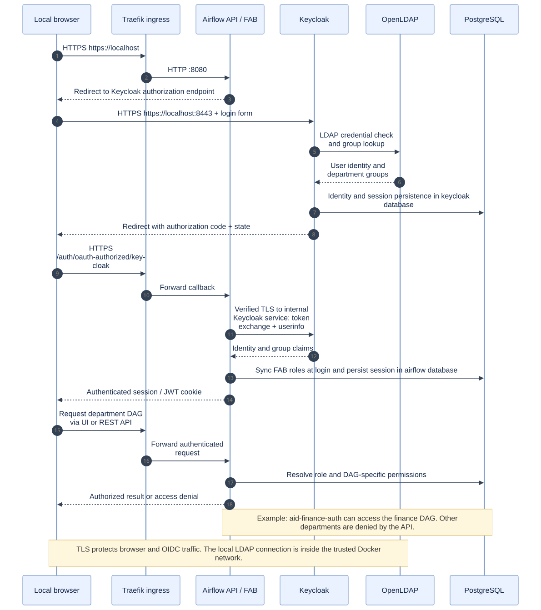

# Architecture of the local Airflow platform

For the **alternate production architecture, tool mapping and deployment steps**, see [Production deployment](PRODUCTION.md). For every local administration UI, see [Login URLs](../ENDPOINTS.md).

This document describes the implemented, hardened local setup. Every runtime service runs on one Linux workstation. Supporting services are **outside the KinD cluster but on the same Docker host and network**. GitHub Actions provides independent code checks.

[System overview](#system-overview) · [Task execution](#task-execution-and-scaling) · [Authentication](#login-and-department-permissions) · [Deployment and CI](#deployment-and-github-ci) · [Storage and boundaries](#storage-and-security-boundaries)

## System overview


[Open full-size SVG](diagrams/overview.svg) · [Editable Mermaid source](diagrams/overview.mmd)

Blue identifies Kubernetes compute, green identifies data services, amber identifies identity/secrets, and purple identifies observability/control. Solid arrows are runtime interactions; dashed arrows are identity checks, scaling actions, or optional build dependencies. The browser is drawn outside the Docker boundary and runs on the same workstation.

The browser reaches Airflow through Traefik at `https://localhost`. Traefik terminates TLS and forwards to the internal API-server Service. Keycloak has its own loopback HTTPS listener at `https://localhost:8443`. Management interfaces and port-forwards bind to `127.0.0.1`.

Pods reach supporting containers through Kubernetes Services with generated Endpoints. `local_cluster.py bridge` inspects each running container's IP on the `kind` network and updates the mapping. These Services provide stable DNS names; the bridge is not an additional proxy process.

| Location | Components | Steady-state sizing |
| --- | --- | --- |
| KinD node / control plane | Kubernetes API, kubelet, default CNI and local storage provisioner | One Docker node on one workstation |
| `ingress-system` namespace | Traefik | One local ingress controller |
| `airflow` namespace | API servers, schedulers, DAG processor, triggerer, Celery workers, StatsD exporter, cleanup CronJob | API x2; scheduler x2; DAG processor x1; triggerer x1; workers x1–3 |
| `keda` namespace | KEDA operator, admission webhook and metrics API | Supplies the worker HPA's external metric |
| `observability` namespace | Prometheus and Grafana | One instance each, separate local PVCs |
| Docker containers outside KinD | PostgreSQL, Redis, Vault, MinIO, Keycloak, OpenLDAP, phpLDAPadmin and Mailpit | Shared local infrastructure; separate named data volumes where applicable |
| Optional Docker service | Nexus artifact proxy | Started separately; not required by default startup |

## Task execution and scaling



[Open full-size SVG](diagrams/runtime.svg) · [Editable Mermaid source](diagrams/runtime.mmd)

1. The release image contains DAGs, provider dependencies, cluster policy and configuration. The DAG processor parses the files and applies department ownership, DAG grants, pools, retries and timeouts.
2. Schedulers use the metadata database to schedule work and submit Celery workloads through the authenticated Redis broker.
3. Workers load task code from the image and use the **internal Execution API**, `http://airflow-api-server.airflow.svc.cluster.local:8080/execution/`, for task execution state. The public browser URL is not the worker endpoint.
4. Celery separately stores execution results in the PostgreSQL `airflow` database. This result-backend connection is shown explicitly; API-based task execution does not make this deployment a database-credential sandbox.
5. Workers obtain the approved S3, SMTP and warehouse connections from Vault using Kubernetes ServiceAccount login. Task logs and finance reports go to local MinIO.
6. KEDA queries `task_instance` rows in PostgreSQL for running/queued tasks on the default queue. The query divides by configured Celery concurrency, **2**, and drives the Kubernetes HPA for **1–3 worker replicas**. It does not use Redis queue depth as its scaling trigger.

Each department pool has two slots. Pools provide concurrency quotas within the shared worker fleet; they are not separate worker identities or security sandboxes. Sizing is defined in [values.yaml](../values.yaml) and [bootstrap_roles.py](../config/bootstrap_roles.py).

The demonstrated data path is:

- Finance completes extraction and calculation, then uploads `reports/finance/<encoded-run-id>/balance_sheet.json` to `airflow-reports`.
- A successful publisher emits the finance-ledger Asset event. An upload exception fails/retries the task and does not publish a successful event.
- The **unpaused** analytics consumer runs from that Asset event and reads `demo_transactions` in the separate `warehouse` database using a read-only account.
- Failure callbacks send email to Mailpit. Prometheus scrapes StatsD; Grafana queries Prometheus and sends operational alerts to the same local inbox.

These are demonstration business workflows. Their output is not real financial or operational reporting.

## Login and department permissions



[Open full-size SVG](diagrams/authentication.svg) · [Editable Mermaid source](diagrams/authentication.mmd)

Airflow uses the FAB auth manager with Keycloak OIDC. Browser redirects and the backchannel token/userinfo exchange use verified TLS. The exact local callback is `https://localhost/auth/oauth-authorized/keycloak`; `https://airflow.local/auth/oauth-authorized/keycloak` is also allowlisted for users who configure that local hostname. Password-grant login is disabled on the Airflow OIDC client.

Keycloak authenticates LDAP users and supplies their groups. Airflow synchronizes group-to-role membership at login. The DAG policy assigns each department role read/edit permissions on its own DAGs. Live tests verify both filtered DAG listings and direct API denial for other departments.

Vault authenticates selected Airflow ServiceAccounts against the Kubernetes API through TokenReview. Their Vault policy grants reads on only these shared connection paths:

- `secret/data/airflow/connections/aws_default`
- `secret/data/airflow/connections/smtp_default`
- `secret/data/airflow/connections/warehouse_default`

The bootstrap root token and unseal key stay in the host's ignored `.local/` directory. Runtime workloads use Kubernetes login rather than the bootstrap root token. API/JWT/Fernet keys and the OIDC client secret are delivered through Kubernetes Secrets during local bootstrap; they are not baked into the Airflow image.

## Deployment and GitHub CI



[Open full-size SVG](diagrams/delivery.svg) · [Editable Mermaid source](diagrams/delivery.mmd)

Use **one lifecycle owner**: `./ctl start` or `./ctl terraform apply`. The Terraform modules orchestrate the same bootstrap scripts and own the KinD resource; provisioners do not provide full drift detection for every service setting.

Startup generates or reuses private local credentials and certificates, builds the release image, starts supporting containers, creates/resumes KinD, installs Secrets and Vault authentication, and maps service endpoints. It then installs ingress/KEDA, loads the image into KinD, runs database migrations in that exact image, deploys Airflow, seeds roles/pools, and installs monitoring. The operator then runs `./ctl smoke` and `./ctl test-auth` explicitly to verify the deployment.

Helm uses readiness waits and atomic rollback for the release. A Helm rollback **does not undo database migrations** that already completed. Review schema compatibility before changing Airflow versions.

GitHub Actions runs on push, pull request and manual dispatch. Its parallel jobs build/test/scan the Airflow image, check Python/Bash and rendered Helm configuration, and validate Terraform. The workflow contains **no deployment step or connection to the local cluster**. A local release changes only when its operator invokes the deployment tools. DAGs do not sync automatically from GitHub.

Initial builds/bootstrap download images, Python packages and Helm charts. Running tasks, authentication, storage, secret lookup and email capture use local services. Preload artifacts for a fully air-gapped installation. See [the setup guide](LOCAL_SETUP.md) for the exact commands.

## Storage and security boundaries

| State | Storage | Behavior and trust boundary |
| --- | --- | --- |
| Airflow metadata and Celery results | PostgreSQL `airflow` database, `airflow` role | Persistent external Docker volume; shared platform state |
| Identity state | PostgreSQL `keycloak` database, `keycloak` role; LDAP named volumes | Shares the PostgreSQL server with Airflow, with separate databases/roles |
| Demo business data | PostgreSQL `warehouse` database, owned by `platform` | Runtime warehouse account has SELECT access to seeded data |
| Broker messages | Redis named volume, append-only persistence | Password authentication on the trusted local Docker network |
| Task logs and reports | MinIO named volume; versioned `airflow-logs` and `airflow-reports` buckets | Logs have a 30-day lifecycle; separate run-specific report keys |
| Vault secrets and audit log | Vault named volume, Raft storage | TLS; scoped runtime policies; local bootstrap keys are a convenience rather than production key custody |
| Metrics and dashboards | Prometheus/Grafana PVCs inside KinD | Survive pod replacement and ordinary stop/start; deleting the KinD node/cluster removes this local storage |
| Captured notifications | Mailpit named volume | SMTP stays local; browser inbox is loopback HTTP |
| Credentials, certificates and local Terraform state | Ignored host files | Never publish `.local/`, environment secrets, private keys or state |

The local CA protects browser, OIDC and Vault connections. Internal PostgreSQL, Redis, LDAP, SMTP, S3 and Execution API traffic relies on the local network trust model and is not all encrypted. Namespace boxes show placement and configuration ownership; **the default KinD CNI does not enforce NetworkPolicy**.

DAG authors are trusted. UI/API RBAC, department pools and shared Vault connection scopes do not isolate malicious task code. All replicas share one physical host, so multiple API servers/schedulers do not provide host-level availability. There is no cloud failover, load-tested production capacity claim, or disaster recovery design in this profile.

## Maintaining the diagrams

The `.mmd` files are the editable source; checked-in SVGs render in the GitHub README and can be opened or shared independently. Rendering requires no change to the running platform:

```bash
python3 docs/diagrams/render.py
```

The helper uses a digest-pinned Mermaid CLI image, preserves SVG text spacing, and adds an explicit white background for portable previews. The renderer image is downloaded on first use. The render itself runs without network access. Change replicas and routing together with [values.yaml](../values.yaml), bootstrap relationships together with [local_cluster.py](../scripts/local_cluster.py), and lifecycle ordering together with [start-local-k8s.sh](../scripts/start-local-k8s.sh). Validate the updated SVGs before committing.
