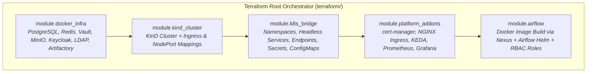

# Local Infrastructure as Code (Terraform) — Apache Airflow 3 Lab

[](https://www.terraform.io/)
[](https://registry.terraform.io/providers/tehcyx/kind/latest)
[](https://registry.terraform.io/providers/kreuzwerker/docker/latest)
[](https://registry.terraform.io/providers/hashicorp/helm/latest)

This directory provides a **100% declarative Terraform configuration** for provisioning the entire local Apache Airflow 3 enterprise lab on Linux or macOS.

Instead of running imperative shell scripts, you can declare, plan, apply, and destroy the complete environment using Terraform.

---

## Architecture Managed by Terraform



---

## Quickstart

### 1. Initialize Terraform
```bash
cd terraform
terraform init
```

### 2. Inspect the Execution Plan
```bash
terraform plan
```

### 3. Apply Infrastructure
```bash
terraform apply
```

### 4. Tear Down Infrastructure
```bash
terraform destroy
```

---

## Or Manage via `./ctl`

You can also control the Terraform lifecycle directly from the project root using [`./ctl`](../ctl):

```bash
# Initialize Terraform providers
./ctl terraform init

# View execution plan
./ctl terraform plan

# Provision the environment
./ctl terraform apply

# Destroy the environment
./ctl terraform destroy
```

---

## Module Breakdown

| Module | Purpose | Provider(s) |
| :--- | :--- | :--- |
| **`modules/docker_infra`** | Manages persistent Docker volumes and external stateful containers (PostgreSQL 16, Redis 7, HashiCorp Vault, MinIO S3, OpenLDAP, phpLDAPadmin, Keycloak 26, Sonatype Nexus 3 OSS). | `kreuzwerker/docker`, `hashicorp/null` |
| **`modules/kind_cluster`** | Provisions the KinD Kubernetes v1.30 cluster with port mappings (80, 443, 8080, 5555) and `ingress-ready=true` node labels. | `tehcyx/kind` |
| **`modules/k8s_bridge`** | Deploys Kubernetes namespaces (`airflow`, `observability`, `keda`), headless Services & Endpoints routing to `172.18.0.1`, ConfigMaps, and Secrets. | `hashicorp/kubernetes` |
| **`modules/platform_addons`** | Installs cert-manager (with Root CA ClusterIssuer), NGINX Ingress Controller, KEDA autoscaler, Prometheus, and Grafana. | `hashicorp/helm`, `hashicorp/kubernetes`, `hashicorp/null` |
| **`modules/airflow`** | Builds the custom Airflow 3 runtime Docker image through Artifactory, deploys the official Airflow Helm release, and seeds AD RBAC roles. | `hashicorp/helm`, `hashicorp/null` |

---

## Customizing Variables

Copy the example variables file to customize settings:

```bash
cp terraform.tfvars.example terraform.tfvars
```

| Variable | Description | Default |
| :--- | :--- | :--- |
| `cluster_name` | Name of the KinD cluster | `"airflow-local"` |
| `airflow_namespace` | Kubernetes namespace for Airflow | `"airflow"` |
| `host_gateway_ip` | Host bridge gateway IP | `"172.18.0.1"` |
| `breakglass_password` | Admin password for break-glass emergency login | `"ChangeMeInSecret123!"` |
| `gmail_app_password` | Optional Google App Password for SMTP alerts | `""` |
| `alert_email` | Sender and recipient email for alert drills | `"alerts@example.com"` |
| `deploy_addons` | Whether to deploy Ingress, cert-manager, KEDA, Observability | `true` |
| `deploy_airflow_helm` | Whether to deploy the Airflow Helm chart | `true` |
